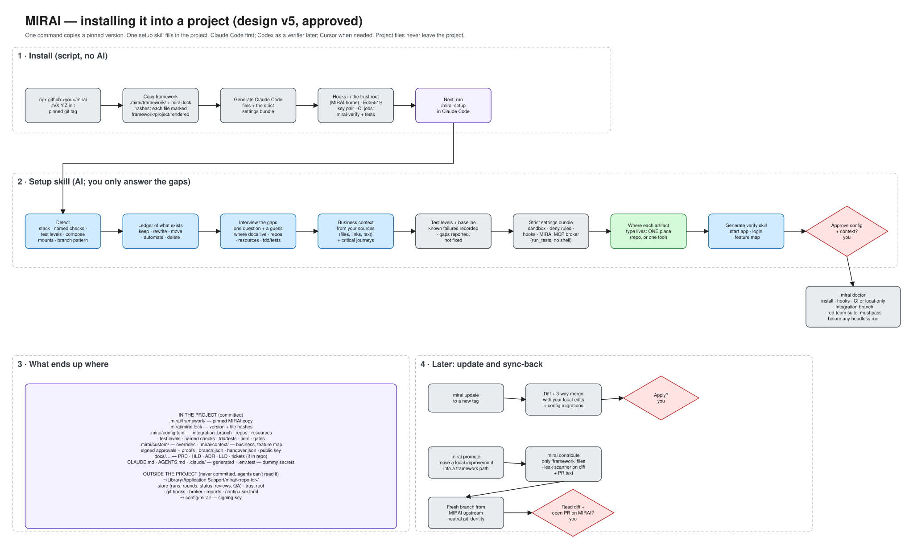
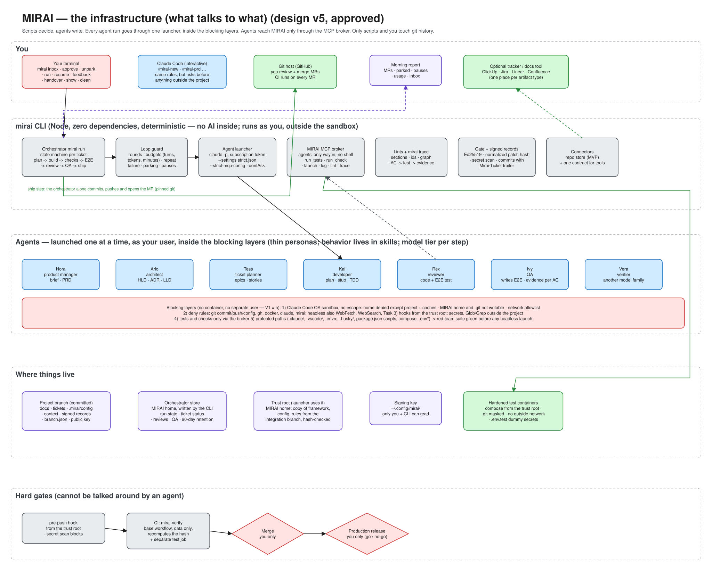
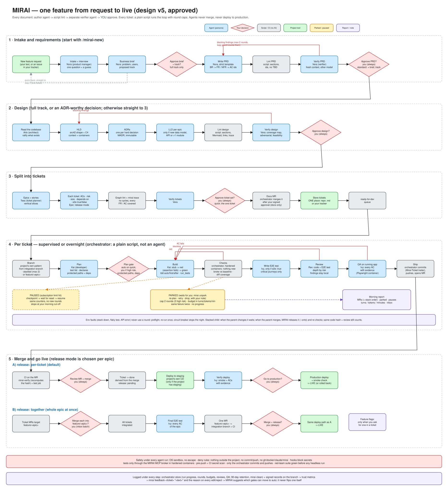

# MIRAI

MIRAI is a reusable, installable framework of agents, skills, workflows, templates and configs. It
takes work from idea to deployment: brief → PRD → design → tickets → plan → build → review → QA →
MR → release. Scripts decide and agents write. Every document and every merge needs your
approval.

**Status:** the design is approved (v5, 2026-10-23). Implementation hasn't started; it runs one
unit at a time from `design/07-implementation-roadmap.md`.

This page is a summary for reading. The real source is the `design/` folder. When they disagree,
`design/` wins.

## 1. Installing MIRAI into a project



1. **Install.** One command, `npx github:<you>/mirai#vX.Y.Z init`, copies a pinned version into
   `.mirai/` and writes a lock file with hashes. The lock marks each file `framework`, `project`
   or `rendered`. The command also:
   - generates the Claude Code files and the strict settings bundle;
   - creates an Ed25519 key pair;
   - installs the git hooks in the MIRAI home and the two CI jobs (`mirai-verify` and tests).
2. **Setup.** `/mirai-setup` in Claude Code:
   - scans the project: stack, named checks, test levels, compose mounts, branch pattern,
     existing AI setups;
   - writes a ledger of what already exists (keep, rewrite, move, automate, delete);
   - asks you only about the gaps, one question with a guess: where each document type lives (one
     place each), the `repos` list, `resources` links, `tdd`/`tests`, the integration branch;
   - builds the business context from your sources and proposes the critical journeys;
   - records the test levels and a test baseline. Existing failures are noted, not fixed;
   - generates the strict settings bundle and the MIRAI MCP broker (`run_tests`, no shell), and a
     verify skill that starts the app.
3. **Approve and check.** You approve the config and context. `mirai doctor` then checks
   everything. Its red-team suite has to pass before any agent runs headless.
4. **Later.** `mirai update` moves to a new version with a 3-way merge, after your approval.
   `mirai promote` and `mirai contribute` send `framework` files back to the MIRAI repo, through a
   leak scanner and a fresh branch, and you read the PR first.

**Where things end up:**
- **In the project:** config, context, documents (if in the repo), signed records, the public key
  and `.env.test` with dummy secrets.
- **Outside the project:** everything MIRAI runs on (store, trust root, hooks, broker, reports)
  is in `~/Library/Application Support/mirai/<repo-id>/`. The signing key is in
  `~/.config/mirai/`. Agents can read neither.

### The `mirai` command on your PATH (unit 12b)

The `mirai` you type is the launcher, `bin/launch.js`. In a repo it runs that repo's pinned
MIRAI, and only when the repo's copy is exactly one committed on the integration branch. It then
runs a sealed copy built from git, never the files in the work tree, which an agent working in
the same checkout could change. `mirai which` says which copy runs, and why. `init` (and later
`update`) always runs the launcher's own MIRAI. On a new machine, or a teammate's fresh clone,
`mirai init --join` sets up only that machine's store.

Point it at a clean release folder, not at a folder where MIRAI is being developed: whatever
that folder holds is what the launcher trusts as its own, and what `init --refresh` copies into
your projects.

```
git clone https://github.com/<you>/mirai ~/Projects/mirai-release
echo "alias mirai='node ~/Projects/mirai-release/bin/launch.js'" >> ~/.zshrc
# after each approved, pushed unit:
git -C ~/Projects/mirai-release pull
```

Once a release is tagged, `npm install -g github:<you>/mirai#vX.Y.Z` installs the same launcher.
Hooks, CI and MCP servers never use it: they call the trust root's copy by its full path.

## 2. The infrastructure: what talks to what



- **The `mirai` CLI is plain code, with no AI inside.** It runs the orchestrator, the loop guard,
  the agent launcher, the lints, the gate and the connectors. It runs as you, outside the sandbox.
- **Agents only write.** The seven personas are Nora, Arlo, Tess, Kai, Rex, Ivy and Vera. Each one
  is started headless, one at a time, through the launcher (`claude -p`, with your subscription
  token and the strict settings).
- **Agents reach MIRAI only through the MCP broker** (`run_tests`, `run_check`, `log`, `lint`,
  `trace`). They have no shell into MIRAI and no git push.
- **The blocking layers (V1 = a):** agents run as your user, with no container. These layers sit
  around them:
  - the OS sandbox;
  - deny rules (no commit, push, `gh`, `docker`, `claude` or `mirai`);
  - hooks;
  - tests only through the broker, in hardened containers;
  - protected paths.

  If the red-team suite finds your Docker socket, SSH agent, keychain or real `.env` reachable,
  headless runs stay blocked until you decide.
- **Only the orchestrator commits, pushes and opens MRs.** Only you merge and release.
- **Where state lives:**
  - signed records travel on the branch;
  - run state, ticket status, reviews and QA results live in the MIRAI home (kept 90 days);
  - the rules come from the trust root, copied from the integration branch, so a branch can't
    loosen its own checks.

## 3. One feature, from request to live



1. **Intake.** Nora interviews you and writes a business brief with a track:
   - **quick:** goes straight to one ticket;
   - **standard:** you approve the brief together with the PRD;
   - **full:** you approve the brief first.
2. **PRD.** Nora writes it from a strict template. A script lints it, and Vera verifies it with
   another model. You approve. There are at most 2 fix rounds.
3. **Design** (full track, or an ADR-worthy decision). Arlo writes the HLD, ADRs and LLDs, then
   lint, Vera, and your approval.
4. **Tickets.** Tess splits the work into vertical slices. Each ticket says whether it needs an
   E2E test, and the epic gets a release mode. Then lint, `mirai trace`, Vera, and your approval.
   The orchestrator merges the docs MR after your signed approval.
5. **Per ticket**, supervised or overnight. A script runs: branch (the project's own pattern) →
   plan → plan gate → build → checks → E2E test (only if needed) → review → QA → ship.
   - The plan gate is auto on the quick track. It's yours on high risk, protected paths or new
     dependencies.
   - Kai writes a stub first, then a failing test, then the code. TDD is `auto`, `on` or `off`.
   - The checks only need nothing new to break against the baseline, and tests for the changed
     lines only.
   - Failures loop back to the developer, at most 2 rounds (3 for high risk). After that the
     ticket is **parked**, and you choose: re-plan, retry or drop.
   - A subscription usage limit **pauses** the run, which resumes after the reset.
   - A dependent ticket can **stack** on its parent's MR, at most 2 levels deep.
6. **Merge and go live.** Each epic picks one release mode.
   - **Per ticket** (the default): CI → you merge → staging (if there is one) → Ivy checks → you
     say go → production + smoke.
   - **Together:** ticket MRs go into `feature/<epic>` → final E2E → one MR to the integration
     branch → release.
   - Feature flags are added only when you ask.
7. **Morning report** after every run: MRs, parked tickets, pauses, usage and your inbox. Use
   `mirai feedback <ticket> "<text>"` when an agent made you go back and forth.

## Where to read more

| File | What it holds |
|---|---|
| [`design/00-interview-log.md`](design/00-interview-log.md) | The requirements interview and every later change |
| [`design/01-workflow.md`](design/01-workflow.md) | The full workflow, stage by stage; §16 is the one gates table |
| [`design/02-architecture-diagram.md`](design/02-architecture-diagram.md) | Eight Mermaid views: lifecycle, stacking, parts, sequence, install, blocking layers, repos, state machines |
| [`design/03-components.md`](design/03-components.md) | Glossary, component catalogue, folder layout |
| [`design/04-decisions.md`](design/04-decisions.md) | Decision log D-01 to D-56 |
| [`design/05-open-questions.md`](design/05-open-questions.md) | Open questions; §G lists the facts still to verify (G1–G29) |
| [`design/06-review-round-*.md`](design/) | The three review rounds and your decisions |
| [`design/07-implementation-roadmap.md`](design/07-implementation-roadmap.md) | 76 units in milestones A–E |
| [`design/08-followup-discussion.md`](design/08-followup-discussion.md) | Follow-up agreements Q1–Q9 |
| [`design/09-post-mvp-plan.md`](design/09-post-mvp-plan.md) | What happens after the MVP |
| [`research/`](research/) | Analysis of prior art, skill vetting, Claude Code blocking rules |

The three drawings above are generated SVGs in [`design/diagrams/`](design/diagrams/).
