# 02 — Architecture diagrams

There are eight views, each explained in plain words underneath. Names match `03-components.md`.
Version 2 applied the round-1 review decisions (`06-review-round-1.md` §G). Version 3 applied the
follow-up agreements Q1–Q9 (`08-followup-discussion.md`). Version 4 applied review round 2
(`06-review-round-2.md`, fixes and decisions U1–U5). Version 5 applies review round 3
(`06-review-round-3.md` §B and decisions V1–V3). **"Integration branch"** below means the
configured `[git] integration_branch`: `main` by default, `mirai/pilot` during the pilot (R3-C1).

---

## (a) The lifecycle

```mermaid
flowchart TD
    S(["Setup: mirai init + /mirai-setup"]) --> I["Intake + brief<br/>product-manager"]
    I --> T{"Track?"}
    T -- quick --> TK
    T -- standard --> P
    T -- full --> BG{{"Human gate: brief + track<br/>full track only"}}
    BG --> P

    P["PRD draft<br/>product-manager"] --> PL["lint prd<br/>script"]
    PL -- fail --> P
    PL -- ok --> PV["Verify PRD<br/>verifier, fresh context"]
    PV -- "blocking, within loop guard" --> P
    PV -- pass --> PG{{"Human gate: PRD<br/>standard: brief + track approved here too"}}
    PG -- changes --> P
    PG -- approved --> D0{"full track or<br/>ADR-worthy decision?"}

    D0 -- no --> TK
    D0 -- yes --> D["HLD / ADR / LLD draft<br/>architect"]
    D --> DL["lint design<br/>script"] --> DV["Verify design<br/>verifier"]
    DV -- blocking --> D
    DV -- pass --> DG{{"Human gate: design"}}
    DG -- changes --> D
    DG -- approved --> TK

    TK["Tickets: epics + stories<br/>ticket-planner"] --> TL["graph + closure + mirai trace<br/>script"] --> TV["Verify tickets<br/>verifier"]
    TV -- blocking --> TK
    TV -- pass --> TG{{"Human gate: ticket set<br/>quick: approve the ticket"}}
    TG -- approved --> DMR["Orchestrator merges the docs MR<br/>after your signed approval, docs only"]
    DMR --> LOOP

    subgraph LOOP ["Per ticket, run by the orchestrator script (the only part that runs overnight)"]
        direction TB
        PN["Plan<br/>developer, declares protected paths<br/>and new dependencies"] --> PNG{{"Plan gate<br/>auto on quick track;<br/>human if high risk or declared paths"}}
        PNG --> B["Build, TDD by setting<br/>developer runs named checks via run_tests"]
        B --> C["Checks by the orchestrator, in hardened containers:<br/>named checks, nothing new broke vs baseline,<br/>diff coverage, floor guard, trace<br/>signed gate-result record"]
        C -- "red, uses a round" --> B
        C -- green --> EW{"e2e: yes?"}
        EW -- yes --> E2W["Write the E2E test<br/>qa, before review"]
        EW -- no --> R
        E2W --> R["Review code + E2E test<br/>reviewer, depth by risk"]
        R -- blocking --> B
        R -- pass --> Q["QA: verify every AC<br/>run_tests in project containers"]
        Q -- fail --> B
        Q -- pass --> SH["Ship: trace + signed proof,<br/>push + open MR<br/>orchestrator, not the agent"]
    end

    B -. "cap or budget hit" .-> PK[["Parked: blocked<br/>with a note"]]
    R -. "cap / no progress / repeat" .-> PK
    Q -. "app won't start" .-> PK

    SH --> RM{"Epic release mode?"}
    RM -- per-ticket --> M{{"You merge the ticket MR"}}
    M --> REL["Release this ticket:<br/>deploy, smoke, your go/no-go"]
    RM -- together --> MF{{"You merge into feature/epic"}}
    MF --> ALL{"All epic tickets merged?"}
    ALL -- no --> LOOP
    ALL -- yes --> E2E["Final E2E: every epic AC<br/>qa, on the feature branch"]
    E2E --> MM{{"You merge feature/epic into the integration branch"}}
    MM --> REL2["Release the epic:<br/>deploy, smoke, your go/no-go"]
    REL --> LIVE(["live"])
    REL2 --> LIVE
    LOOP --> RP["Run report / morning report"]
    PK --> RP
```

**In plain words:**
- **Documents:** every document goes author → cheap script check → separate verifier → **you**. A
  document only feeds the next stage after you approve it. No document gate can be `auto` (D6).
- **Gates by track (U4, R3-M4):** `quick` = approve the ticket, then merge (2 actions; 3 once
  the release stage adds your go/no-go). The quick plan gate is `auto`. `standard` = the brief is
  approved together with the PRD. `full` keeps its own brief gate. Approved documents reach the
  integration branch through one docs MR, which **the orchestrator merges after your signed
  ticket-set approval** (V3); it carries documents only. `01` §16 is the one gates table.
- **The build loop:** a script runs the per-ticket loop, not an agent. Each arrow back to "Build"
  after handover uses one round of the ticket's shared budget, which covers checks, review and QA
  together. Failures the developer fixes inside its own session don't count. The orchestrator,
  not the agent, commits after each green step.
- **E2E before review (U2):** when `e2e: yes`, QA writes the E2E test before review, so the
  reviewer checks it with the code and one proof covers both.
- **No ship gate:** push and MR are automatic; your merge is the gate.
- **Parking:** when the budget runs out, the ticket is parked with a note instead of retried.
- **Tests:** `tdd` and `tests` settings decide how tests are written. The gate checks that nothing
  new broke against the test baseline, and only changed lines need tests (diff coverage). E2E
  tests exist only for critical journeys and are written by QA, not the developer.
- **Models:** each step runs at its tier (0 no AI, `light`, `standard`, `deep`). Only `light`
  steps escalate, once. The verifier uses another family, else another Claude model, else the
  same model in fresh context (logged).
- **Release:** an epic is released ticket by ticket (the default), or all together through a
  feature branch with a final E2E test (D3).
- **Merging:** no code merges without you, anywhere. The docs MR is the only merge MIRAI
  performs (V3).

---

## (b) Stacked tickets inside one epic

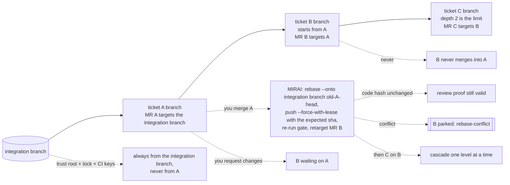

**In plain words:**
- **Starting early:** if B needs A and A's MR is open but not merged, B starts from A's branch. B's
  MR shows only B's changes.
- **Limits:** at most two levels deep (A → B → C), and only inside one epic (D2).
- **No double review:** when A merges, B is moved onto the integration branch with
  `rebase --onto`, which also works after a squash merge. The code hash is a normalized patch (no
  blob IDs, no line numbers, R3-M11), so if B's own change is the same, its review still counts.
  Only the quality gate re-runs. The orchestrator pushes with `--force-with-lease`, naming the
  exact commit it expects, and records A's head every time it pushes A.
- **Rules from the integration branch:** a stacked ticket always runs under the trust root and
  lock from the integration branch, never from its unmerged parent (R2-M6). CI verifies B against
  the integration branch's keys and lock too (R3-M10).
- **B never merges into A.** B's MR targets A only so you see B's diff; it is retargeted before
  it can be merged.
- **In a `together` epic** the same picture applies, with `feature/<epic>` in place of the
  integration branch.

---

## (c) How the parts relate

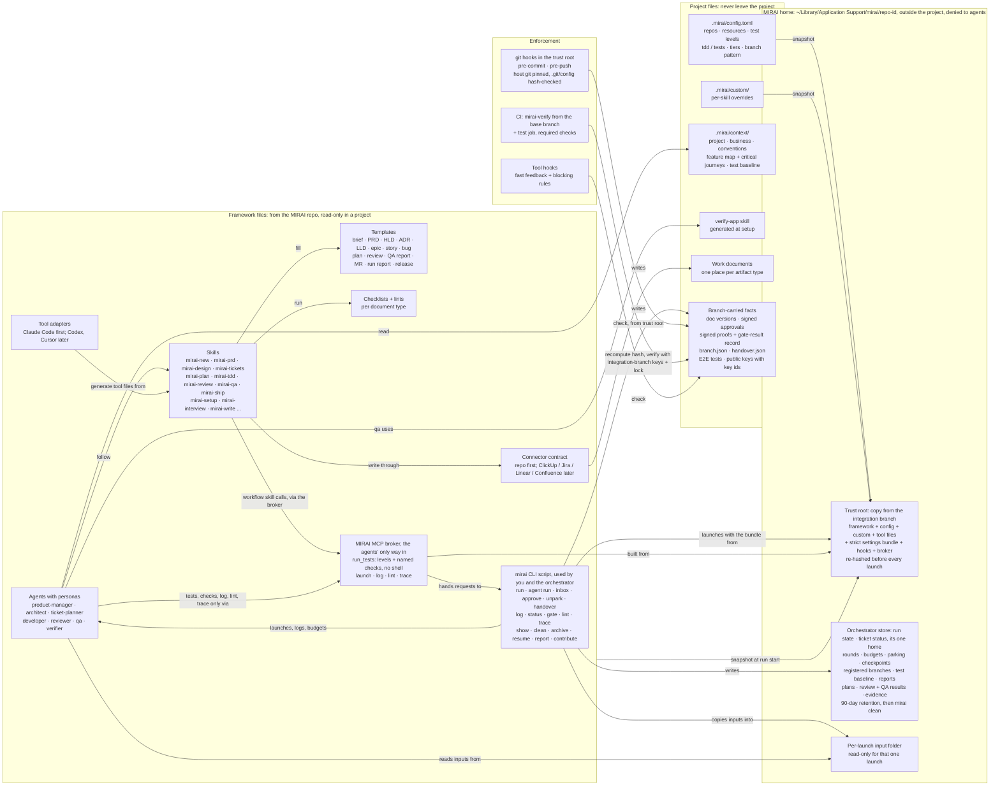

**In plain words:**
- **Skills hold the procedures. Agents are personas that follow skills.**
- **The `mirai` CLI** is the one thing that launches agents, writes logs, picks models and
  enforces budgets (D-12). **Agents and workflow skills never run it directly** (R3-C3): it needs
  the MIRAI home, which the sandbox denies. They use the narrow **MIRAI MCP broker**, which runs
  outside the sandbox as the orchestrator. Inputs reach an agent through a per-launch read-only
  folder; outputs come back only as structured output.
- **The MIRAI home (R2-C1):** the trust root, the orchestrator store and the hooks live in
  `~/Library/Application Support/mirai/<repo-id>/`, outside the project. Agents can neither read
  nor write it, and they can't write `.git/**`. So a ticket branch can't relax the gate that
  checks it (R-C2), and an agent can't reset its own counters.
- **Two kinds of state:**
  - facts that belong to an MR (approvals, proofs) travel on its branch;
  - run bookkeeping lives in the orchestrator store and is never committed (R-C4). One machine in
    the MVP (U3).
- **Verdicts** come from the agents' structured output captured by the launcher, never from files.
- **Where results live:** review and QA results stay in the orchestrator store and are never
  posted to the git host. Only small signed files are committed: the proofs, the gate-result
  record, `branch.json` and `handover.json` (so CI can see which branches are MIRAI's). The MR gets one line,
  `Review: PASS after N rounds (MIRAI)`, plus QA as text.
- **Sync-back:** it can only ever read the framework side (D-21).

---

## (d) One feature, from idea to live

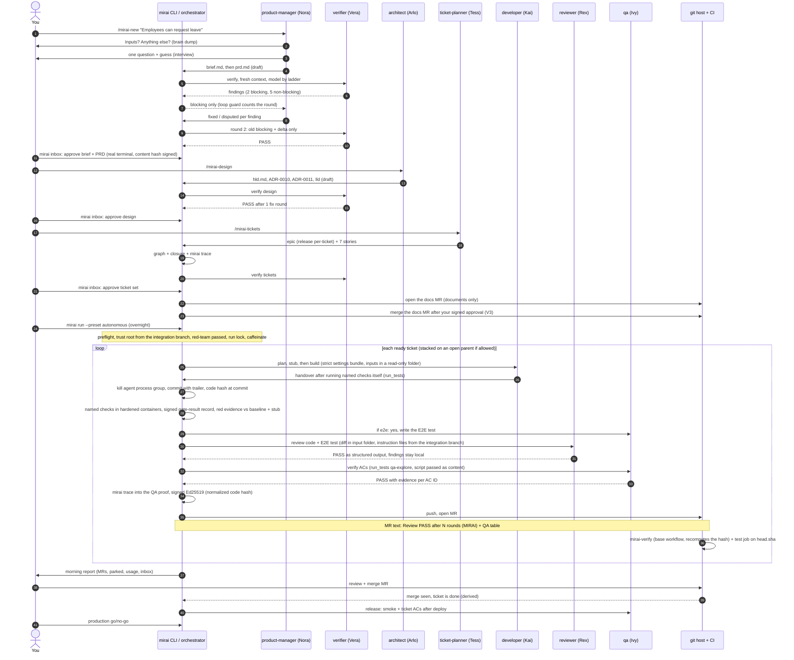

---

## (e) Install, update and sync-back

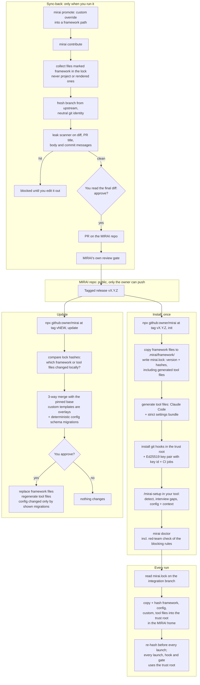

**In plain words:**
- **What a project may change:** framework files are copied and pinned. A project changes behavior
  through config and `.mirai/custom/` overrides. A direct edit to a framework file or a generated
  tool file shows up in the lock hash.
- **Every run** takes its rules from a trust root copied from the integration branch, never from
  the branch being checked, and re-hashes it before every launch.
- **The lock marks each file `framework`, `project` or `rendered`** (R2-M12, R3-M13).
  `framework` files come from MIRAI as they are. `project` files hold project content, such as
  `verify-<app>`. `rendered` files are generated from framework templates plus project data, such
  as the tool files and the managed `AGENTS.md` block; their template is framework, their output
  isn't. `contribute` carries only `framework` files (and template changes behind `rendered`
  ones), never `project` or rendered output.
- **Updates** ask first. They merge your local edits three ways instead of overwriting them.
- **Contribute** only ever carries framework-file changes. It builds a fresh branch from upstream
  and scans the final text, and you read the final diff (R-M14).

---

## (f) The blocking layers (D7)

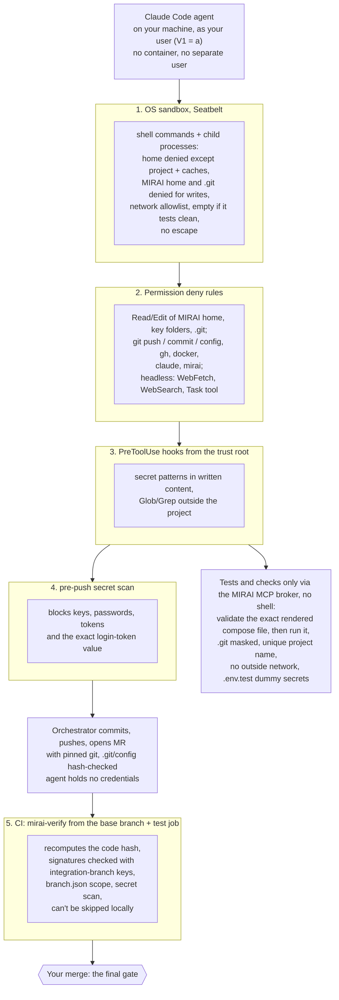

**In plain words:**
- **Why these layers:** each covers a gap the others leave
  (`research/09-claude-blocking-rules.md` §7):
  - the sandbox covers code the agent writes and runs;
  - the deny rules cover the file tools;
  - hooks cover Glob/Grep;
  - `run_tests` replaces any shell exception, and the containers it starts have no route out;
  - the two secret scans catch anything that reaches a commit.
- **MIRAI's own files are out of reach (R2-C1):** the store, trust root and hooks are in the MIRAI
  home outside the project, and agents can't write `.git/**`, neither from the shell nor from a
  test container (`.git` is masked there, R3-C4). MIRAI's own git calls refuse to run if
  `.git/config` changed.
- **The login token:** the agent can read it. Test containers have no network, WebFetch and
  `claude` are denied, and a commit containing it is blocked. If the sandbox allowlist must keep
  the package registries, an upload there remains a possible route (R3-M5); setup tests an empty
  allowlist first.
- **What's not covered (V1 = (a)):** there's no OS boundary between the agent and you. Files
  that run by themselves (`.vscode` tasks, `.envrc`, `.husky`, `package.json` scripts) fire when
  you open a branch, so they're protected paths and the report warns you first. If the red-team
  tests find your docker socket, ssh-agent, keychain or real `.env` reachable and not closable
  by configuration, headless runs are blocked and the decision comes back to you.
- **What changes by mode:** interactive sessions **ask** before anything outside the project;
  headless runs **deny** it.
- **Browsers:** E2E tests and Ivy's overnight checks run in the Playwright container
  (`run_tests` levels `e2e` and `qa-explore`). Playwright MCP runs outside the sandbox, so it's
  used only in interactive daytime sessions, never headless.

---

## (g) One repo or several

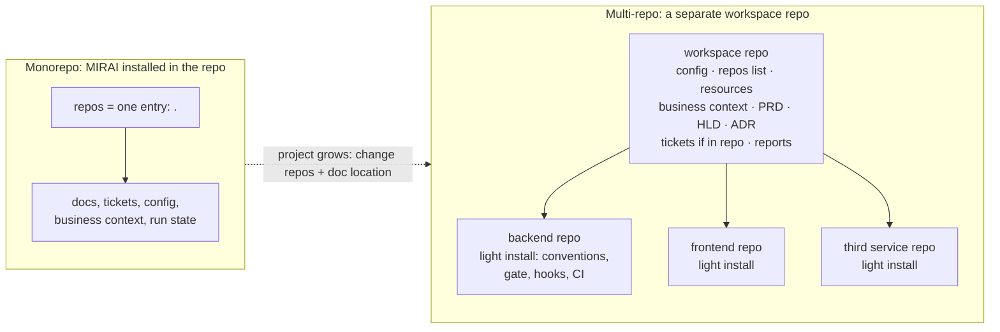

**In plain words:**
- **Same model for both:** a `repos` list in config. A monorepo has one entry; a workspace repo
  points to the service repos (`08` Q3).
- **No document copies in service repos:** documents live once, in the workspace repo or the one
  configured tool (D5).
- **Every ticket belongs to one repo.** Cross-repo work starts with an interface ticket, then one
  ticket and one MR per repo.
- **Cross-repo E2E** is `local`, `deployed` or `none` (a manual check for you, flagged in the
  report).
- **Where proofs live (R2-C7):** a ticket's proofs are committed on the **service repo's** ticket
  branch, because they're about that repo's code. Documents and approvals live in the workspace
  repo. Each service repo's lock pins the workspace's public key and gate config version, and
  `mirai trace` runs from the workspace. Each repo has its own integration branch setting. Built
  in Milestone D (see 07).

---

## (h) Status state machines

### Documents (brief, PRD, HLD, LLD, ADR, ticket set, context files)

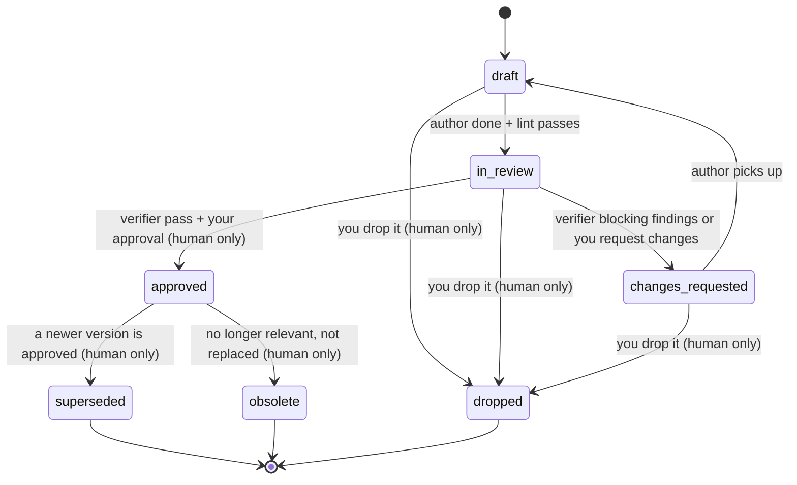

**Rules:**
- **Human-only moves:** `approved`, `superseded`, `obsolete` and `dropped` can only be set through
  `mirai inbox` / `mirai approve` / `mirai drop`. These need a real terminal and write signed
  events that include the document's content hash (D-17, R-M1, R2-M11).
- **Frozen versions:** an approved version is never edited. A change starts
  `<doc>.v<N+1>.draft.md` beside it.
- **Current state vs history, for documents:** frontmatter is the current state, and the run log
  is the history. A mismatch is an error.
- **Storage:** each artifact type lives in exactly one place (D5). When that place is an external
  tool, the status lives there and the repo keeps only a pointer. MIRAI's gates never depend on it:
  they use only the signed proofs; tracker status is read from a local cache with a last-sync time
  and is advisory (R2-M13).

### Tickets

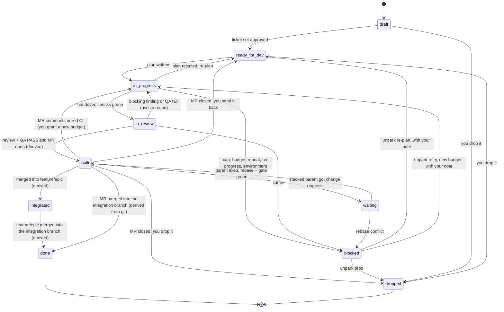

**Rules:**
- **Where status lives (R2-M5, R3-M12):** ticket status is not in the ticket's frontmatter. It
  has **one home**, the per-ticket status file in the orchestrator store. A tracker, if used, gets
  a mirrored copy that is advisory.
- **Derived states win:** `done` and `integrated` always win (a merged ticket is never
  `blocked`). `built` wins over written states from before the MR's latest head push; a written
  `in_progress` or `waiting` after that push takes over until the next push with valid proofs.
- **Derived states:** `built`, `integrated` and `done` are computed from MRs and merges, never
  written (R-C4). `integrated` means merged into `feature/<epic>` in a `release: together` epic;
  the next ticket's `after` rule accepts it, so the epic can't deadlock. `done` there means that
  branch is merged into the integration branch.
- **Parking:** `parked` (Q7) is the `blocked` state plus a required `park_reason` and a parking
  note. Only `mirai unpark`, with your note and a choice of **re-plan**, **retry** or **drop**,
  takes a ticket out of it.
- **Handover:** `mirai handover <ticket>` releases the branch to you; the ticket leaves MIRAI's
  machine and its gates. A signed `handover.json` is committed, so CI stops applying MIRAI's
  rules too.
- **Human-only moves:** only a human action leads to `dropped`, grants a new budget after MR
  comments, or merges. No agent moves a ticket past `built`.
- **Logging:** every transition is one line in the run log, with `by` (agent, script or human) and
  the reason.

### Epic (`release: together`)

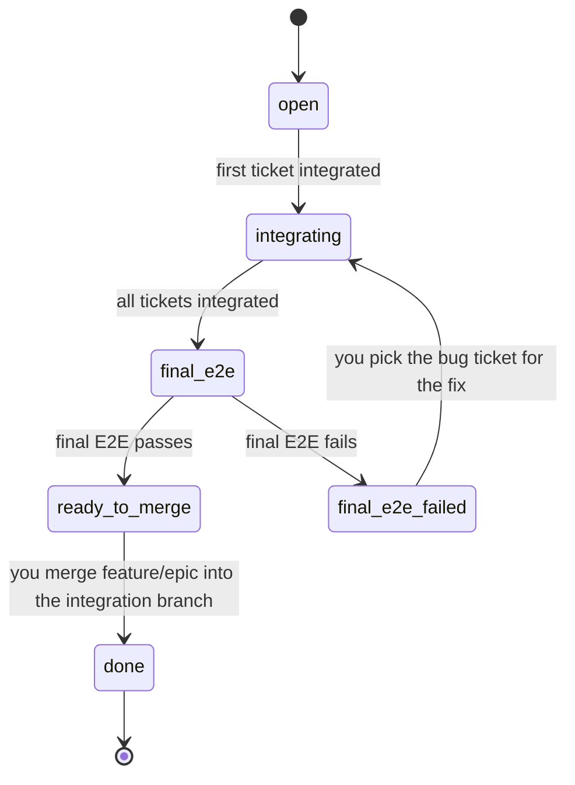

### Run

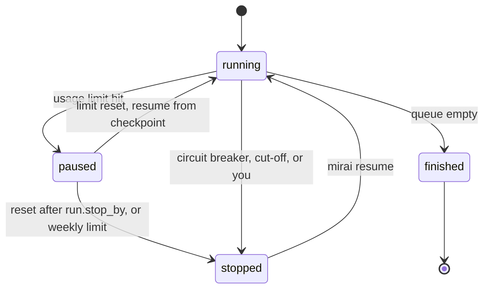

### Release record

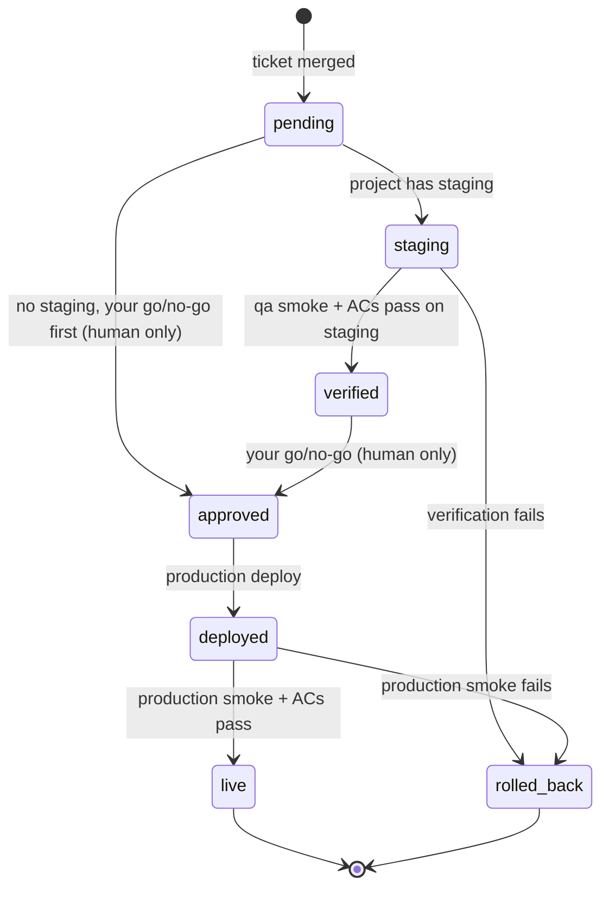

**Release rules:** staging is optional; nothing assumes it. Without staging, your go/no-go comes
first, and the smoke check and ACs run after the production deploy. The release record lives in
the store and is exported as a git tag annotation or a host release. A PRD's `live` state is
derived, never written.
