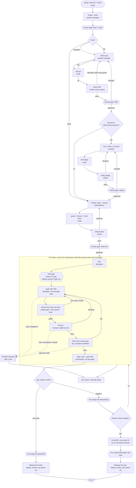
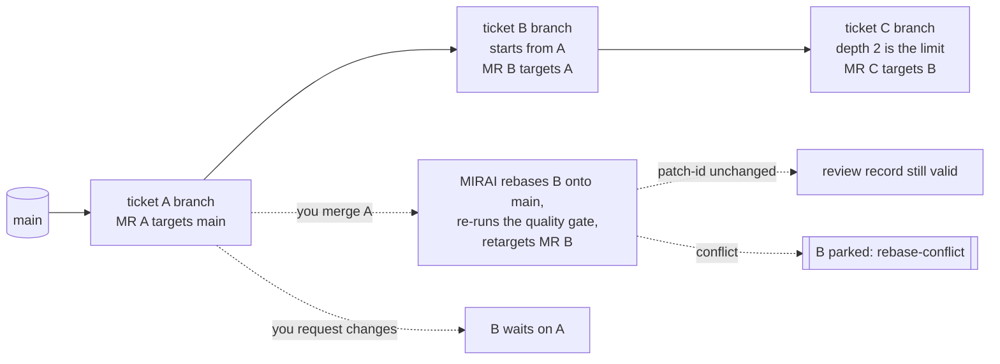
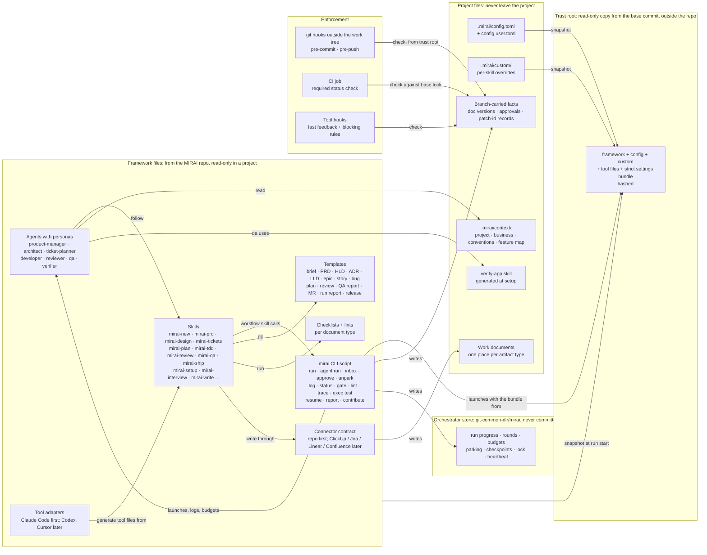
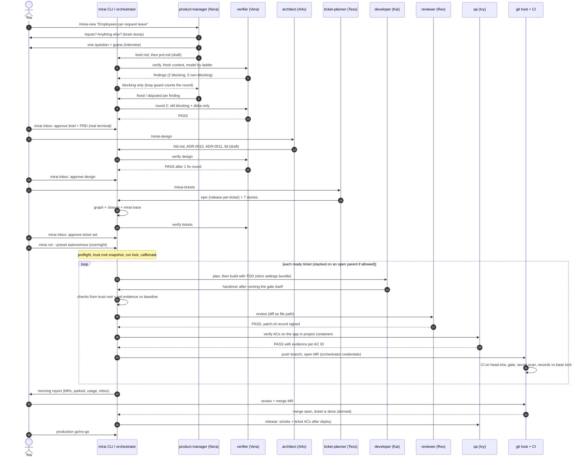
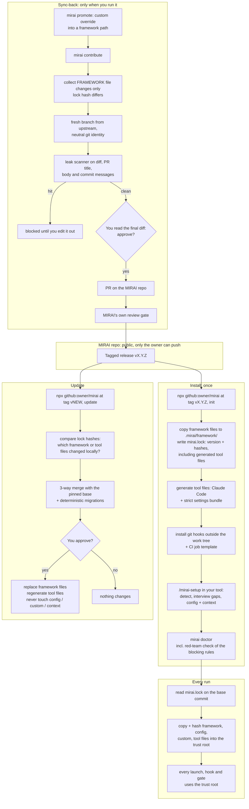
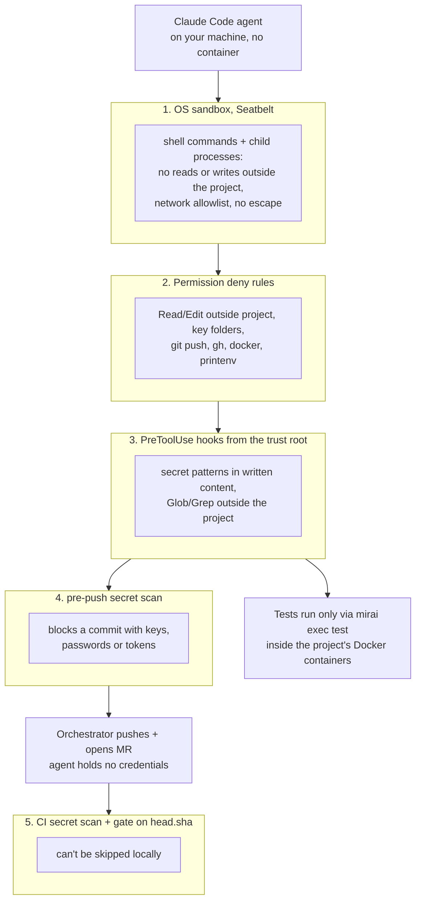
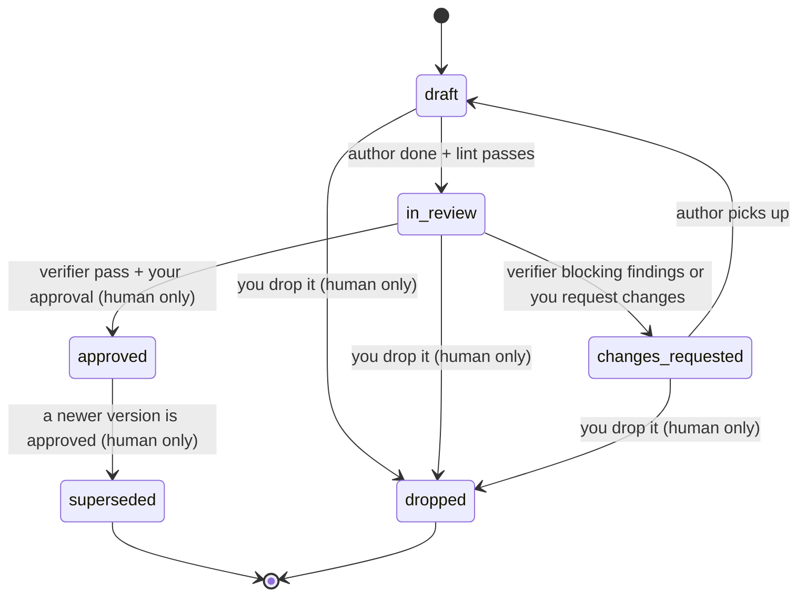
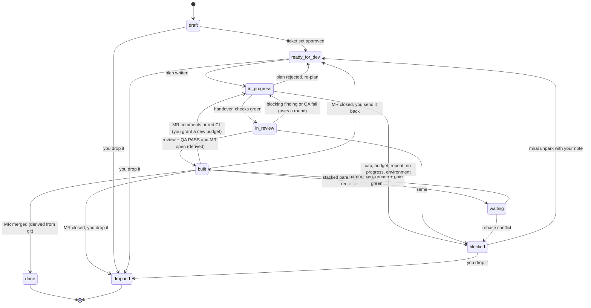
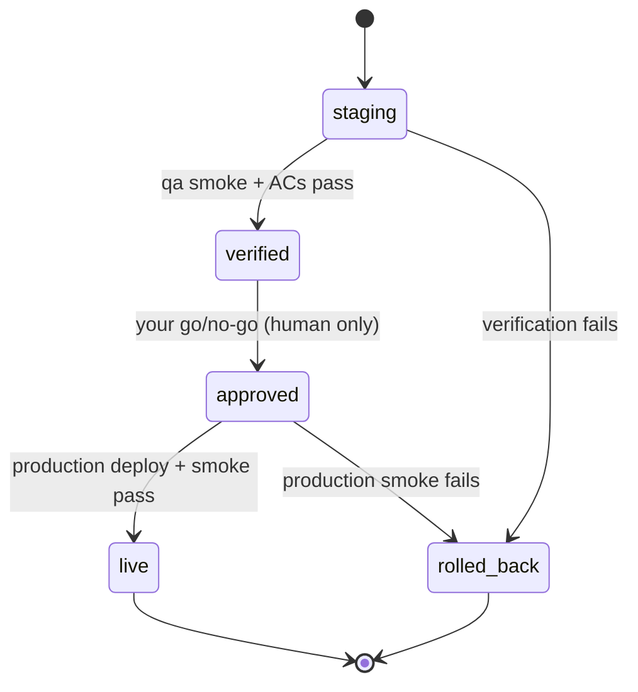

# 02 — Architecture diagrams

There are seven views, each explained in plain words underneath. Names match `03-components.md`.
Version 2 applies the round-1 review decisions (`06-review-round-1.md` §G).

---

## (a) The lifecycle

**In plain words:**
- **Documents:** every document goes author → cheap script check → separate verifier → **you**. A
  document only feeds the next stage after you approve it. No document gate can be `auto` (D6).
- **The build loop:** a script runs the per-ticket loop, not an agent. Each arrow back to "Build"
  after handover uses one round of the ticket's shared budget, which covers checks, review and QA
  together. Failures the developer fixes inside its own session don't count.
- **Parking:** when the budget runs out, the ticket is parked with a note instead of retried.
- **Release:** an epic is released ticket by ticket (the default), or all together through a
  feature branch with a final E2E test (D3).
- **Merging:** nothing merges without you, anywhere.

---

## (b) Stacked tickets inside one epic

**In plain words:**
- **Starting early:** if B needs A and A's MR is open but not merged, B starts from A's branch. B's
  MR shows only B's changes.
- **Limits:** at most two levels deep (A → B → C), and only inside one epic (D2).
- **No double review:** when A merges, B is moved onto `main`. If B's own change is the same
  (same patch-id), its review still counts. Only the quality gate re-runs.
- **In a `together` epic** the same picture applies, with `feature/<epic>` in place of `main`.

---

## (c) How the parts relate

**In plain words:**
- **Skills hold the procedures. Agents are personas that follow skills.**
- **The `mirai` CLI** is the one thing that launches agents, writes logs, picks models and
  enforces budgets (D-12).
- **The trust root:** every launch, hook and gate reads MIRAI's rules from a **trust root**, a
  copy taken from the base commit. So a ticket branch can't relax the gate that checks it (R-C2).
- **Two kinds of state:**
  - facts that belong to an MR (approvals, records) travel on its branch;
  - run bookkeeping lives in the orchestrator store and is never committed (R-C4).
- **Sync-back:** it can only ever read the framework side (D-21).

---

## (d) One feature, from idea to live

---

## (e) Install, update and sync-back

**In plain words:**
- **What a project may change:** framework files are copied and pinned. A project changes behavior
  through config and `.mirai/custom/` overrides. A direct edit to a framework file or a generated
  tool file shows up in the lock hash.
- **Every run** takes its rules from a trust root copied from the base commit, never from the
  branch being checked.
- **Updates** ask first. They merge your local edits three ways instead of overwriting them.
- **Contribute** only ever carries framework-file changes. It builds a fresh branch from upstream
  and scans the final text, and you read the final diff (R-M14).

---

## (f) The blocking layers (D7)

**In plain words:**
- **Why five layers:** each layer covers a gap the others leave
  (`research/09-claude-blocking-rules.md` §7):
  - the sandbox covers code the agent writes and runs;
  - the deny rules cover the file tools;
  - hooks cover Glob/Grep;
  - the two secret scans catch anything that reaches a commit.
- **What changes by mode:** interactive sessions **ask** before anything outside the project;
  headless runs **deny** it.

---

## (g) Status state machines

### Documents (brief, PRD, HLD, LLD, ADR, ticket set, context files)

**Rules:**
- **Human-only moves:** `approved`, `superseded` and `dropped` can only be set through
  `mirai inbox` / `mirai approve` / `mirai drop`. These need a real terminal and write signed
  events (D-17, R-M1).
- **Frozen versions:** an approved version is never edited. A change starts
  `<doc>.v<N+1>.draft.md` beside it.
- **Current state vs history:** frontmatter is the current state, and the run log is the history.
  A mismatch is an error.
- **Storage:** each artifact type lives in exactly one place (D5). When that place is an external
  tool, the status lives there and the repo keeps only a pointer.

### Tickets

**Rules:**
- **Derived states:** `built` and `done` are computed from MRs and merges, never written (R-C4).
  `done` in a `together` epic means merged into `feature/<epic>` *and* that branch merged into
  `main`.
- **Parking:** `parked` (Q7) is the `blocked` state plus a required `park_reason` and a parking
  note. Only `mirai unpark`, with your note, takes a ticket out of it.
- **Human-only moves:** only a human action leads to `dropped`, grants a new budget after MR
  comments, or merges. No agent moves a ticket past `built`.
- **Logging:** every transition is one line in the run log, with `by` (agent, script or human) and
  the reason.

### Release record

