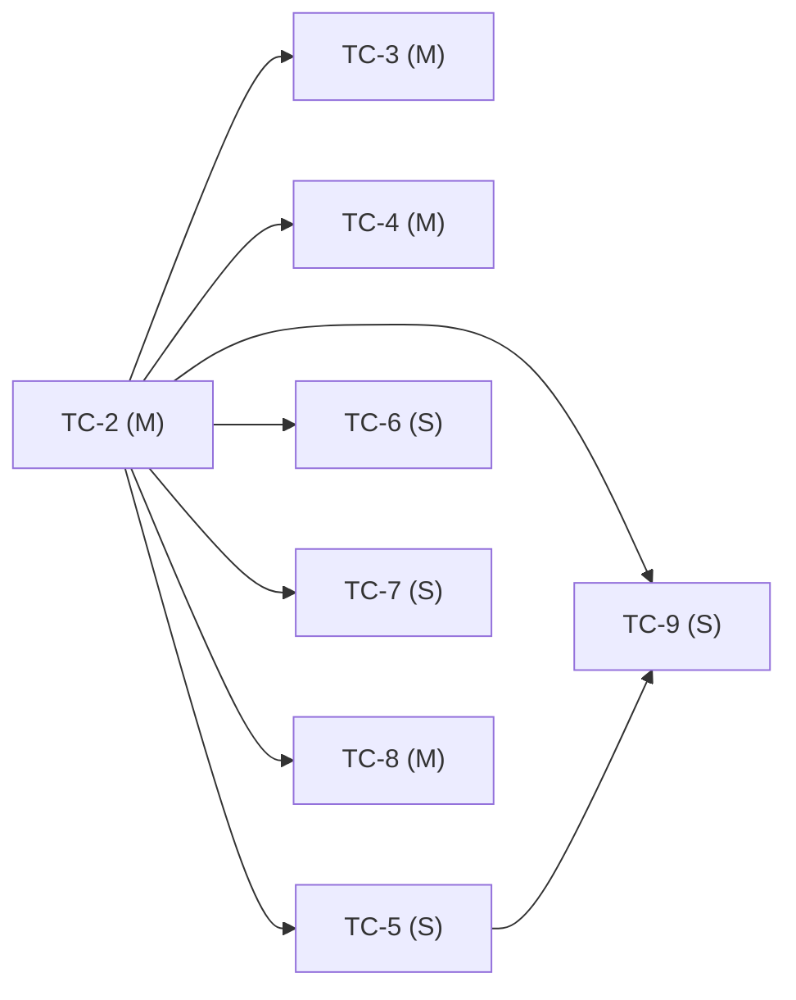

# Comments on tasks, safe to release to one team

PRD: [Comments on tasks, so the reasons stay with the task](prd.md)

## Summary for approval

### The ask

Approve tickets TC-2 to TC-9, so that viewers can record and read the reasons behind a task inside the app (PRD, SM-1).

### Why

The set builds plain-text comments on a task, with access rules, notifications and failure handling. A thin write-and-read path comes first, then access control, the riskiest part. The rest builds on that path and can run side by side. The PRD holds the reasons and evidence.

### What changes

- Viewers write comments and read all of them, oldest first, with author and time; comments cannot be edited or deleted (TC-2; FR-1, FR-2, FR-3, FR-5)
- Tasks without comments look and work as today (TC-2; FR-15)
- Only viewers can read or write comments; losing access hides them, and task access rules stay the same (TC-3; FR-6, FR-12, FR-16, NFR-3)
- The owner and assignee get one in-app notification per comment; a failed notification never loses the comment (TC-4; FR-4, FR-11, FR-14)
- Empty, oversized and failed comments are refused with a message, keeping the typed text; simultaneous comments both stay (TC-5, TC-6; FR-8, FR-9, FR-10, FR-13)
- Deleting a task deletes its comments (TC-7; FR-7)
- Comments save and load within 2 seconds and work by keyboard alone (TC-8, TC-9; NFR-1, NFR-2, NFR-4)

### Decisions for you

1. Release together (TC-1): comments must not reach users before access control (TC-3) is in. Per-ticket release would expose them.
2. Access control (TC-3) is risk: high: a mistake leaks comments to people who cannot see the task.
3. Task deletion (TC-7) is risk: high: it deletes data, and a mistake leaves comments readable or removes the wrong ones.
4. The comment journey (TC-2) is e2e: true: it creates the new journey of writing and reading a reason on a task.

The tickets assume the PRD's open choices Q-1, Q-2 and Q-3 go as recommended (A-1, A-2, A-3).

### Not in this

- Replacing or linking the chat tool, because it serves other needs (NG-1)
- File attachments, formatting, mentions and reactions, to keep to the appetite (NG-2, NG-5)
- Comments by outsiders, old chat history and search across comments (NG-3, NG-4, NG-6)
- Reports or tracking for the success metrics, because no requirement asks for them (NG-7)
- A per-team switch for the first release, because no requirement asks for one (NG-8)

## Order

TC-2 comes first: the thinnest path from the task page to stored comments and back. TC-3 comes next, because access control is the part the team is least sure of. After TC-2, the tickets TC-3 to TC-8 can run side by side. TC-9 waits for TC-5, since keyboard users must reach its error messages.

## Release

The mode is together. Comments written in TC-2 would be readable past the access rules until TC-3 ships. Releasing the set as one piece keeps BR-4 intact from day one.

## Not in this epic

- NG-1 to NG-6: the PRD's and brief's non-goals, as listed in the PRD.
- NG-7: No report, log or tracking built for SM-1 or SM-2. The PRD has no requirement for it, and SM-1 uses the app's own data.
- NG-8: No per-team switch for the brief's one-team-first release (R-2). The PRD has no requirement for it; if needed, it goes back to the PRD.

## Tickets

<!-- generated by mirai epic render: edit the tickets, then run it again -->
| Key | Title | Size | Risk | After | FRs | ACs | ADRs |
|---|---|---|---|---|---|---|---|
| [TC-2](tickets/TC-2.md) | Viewers write and read plain-text comments on a task | M | normal | — | FR-1, FR-2, FR-3, FR-5, FR-15 | AC-FR-1.1, AC-FR-2.1, AC-FR-3.1, AC-FR-5.1, AC-FR-15.1 | — |
| [TC-3](tickets/TC-3.md) | Only people who can see a task can read or write its comments | M | high | TC-2 | FR-6, FR-12, FR-16, NFR-3 | AC-FR-6.1, AC-FR-12.1, AC-FR-12.2, AC-FR-16.1 | — |
| [TC-4](tickets/TC-4.md) | The owner and assignee are told in the app when someone comments | M | normal | TC-2 | FR-4, FR-11, FR-14 | AC-FR-4.1, AC-FR-4.2, AC-FR-4.3, AC-FR-14.1, AC-FR-14.2, AC-FR-11.1 | — |
| [TC-5](tickets/TC-5.md) | Empty, oversized and failed comments are refused without losing the text | S | normal | TC-2 | FR-8, FR-9, FR-10 | AC-FR-8.1, AC-FR-9.1, AC-FR-10.1 | — |
| [TC-6](tickets/TC-6.md) | Two comments submitted at the same moment both stay | S | normal | TC-2 | FR-13 | AC-FR-13.1 | — |
| [TC-7](tickets/TC-7.md) | Deleting a task deletes its comments | S | high | TC-2 | FR-7 | AC-FR-7.1 | — |
| [TC-8](tickets/TC-8.md) | Comments save and load within 2 seconds | M | normal | TC-2 | NFR-1, NFR-2 | — | — |
| [TC-9](tickets/TC-9.md) | Comments work with the keyboard alone | S | normal | TC-2, TC-5 | NFR-4 | — | — |
<!-- end of the generated part -->

## Dependencies

<!-- generated by mirai epic render: edit the tickets, then run it again -->

<!-- end of the generated part -->

## Coverage

<!-- generated by mirai epic render: edit the tickets, then run it again -->
| ID | Group | Tickets |
|---|---|---|
| FR-1 | Capabilities | TC-2 |
| AC-FR-1.1 | Capabilities | TC-2 |
| FR-2 | Capabilities | TC-2 |
| AC-FR-2.1 | Capabilities | TC-2 |
| FR-3 | Capabilities | TC-2 |
| AC-FR-3.1 | Capabilities | TC-2 |
| FR-4 | Triggers and states | TC-4 |
| AC-FR-4.1 | Triggers and states | TC-4 |
| AC-FR-4.2 | Triggers and states | TC-4 |
| AC-FR-4.3 | Triggers and states | TC-4 |
| FR-5 | Triggers and states | TC-2 |
| AC-FR-5.1 | Triggers and states | TC-2 |
| FR-6 | Triggers and states | TC-3 |
| AC-FR-6.1 | Triggers and states | TC-3 |
| FR-7 | Triggers and states | TC-7 |
| AC-FR-7.1 | Triggers and states | TC-7 |
| FR-8 | Failures | TC-5 |
| AC-FR-8.1 | Failures | TC-5 |
| FR-9 | Failures | TC-5 |
| AC-FR-9.1 | Failures | TC-5 |
| FR-10 | Failures | TC-5 |
| AC-FR-10.1 | Failures | TC-5 |
| FR-11 | Failures | TC-4 |
| AC-FR-11.1 | Failures | TC-4 |
| FR-12 | Failures | TC-3 |
| AC-FR-12.1 | Failures | TC-3 |
| AC-FR-12.2 | Failures | TC-3 |
| FR-13 | Failures | TC-6 |
| AC-FR-13.1 | Failures | TC-6 |
| FR-14 | Failures | TC-4 |
| AC-FR-14.1 | Failures | TC-4 |
| AC-FR-14.2 | Failures | TC-4 |
| FR-15 | Unchanged behaviour | TC-2 |
| AC-FR-15.1 | Unchanged behaviour | TC-2 |
| FR-16 | Unchanged behaviour | TC-3 |
| AC-FR-16.1 | Unchanged behaviour | TC-3 |
| NFR-1 | Non-functional | TC-8 |
| NFR-2 | Non-functional | TC-8 |
| NFR-3 | Non-functional | TC-3 |
| NFR-4 | Non-functional | TC-9 |
<!-- end of the generated part -->

## Design decisions

<!-- generated by mirai epic render: edit the tickets, then run it again -->
None — no ticket names an ADR in `governed_by`.
<!-- end of the generated part -->
