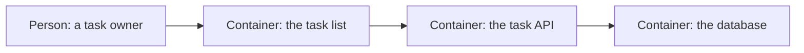
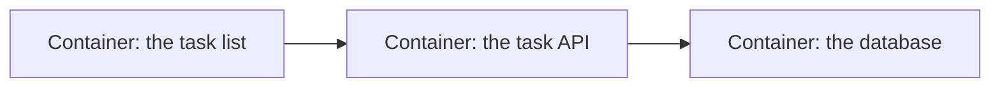
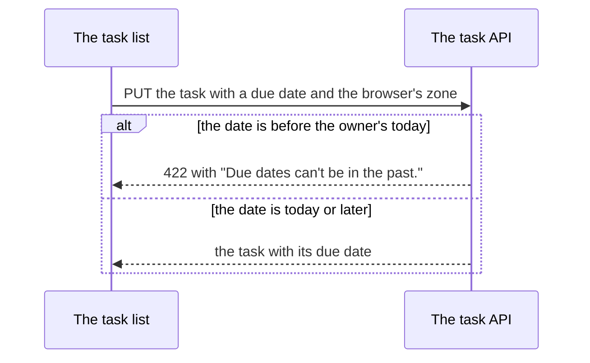

# Due dates on my own tasks: one column, checked on both sides

PRD: [Due dates on my own tasks](prd.md)

## Summary for approval

### The ask

Approve this design for due dates on a person's own tasks, built in the existing task API and task list.

### Why

A due date is one nullable column on the task, set through the task API and shown by the list (D-2). The owner's own day decides what is past and what is late, taken from the zone the browser sends (ADR-0001).

### What changes

- A task gains a due date, set, changed or removed by its owner (D-2)
- The server refuses a date before the owner's today (ADR-0001)
- The list shows the date and marks an open task late from the day after (D-3)
- Editing a task's title no longer lets another user change it (D-5)
- A task without a date is shown and sorted as today (D-4)

### Decisions for you

1. How does the app know the owner's today (ADR-0001)? A: the browser sends its time zone with each write (recommended). B: a time zone stored on each user. C: every date judged in UTC. Written for: A.

### Not in this

- A page of late tasks, which the PRD leaves out (NG-4)
- A time zone setting per user, which ADR-0001 rejects (NG-5)

## Goals and quality goals

Every requirement is met while a task's date stays its owner's alone.

- Another user opens their list → 0 dates of someone else's tasks are shown (NFR-1).

## Context and scope

- Outside the system: the browser's clock and time zone, which the design relies on and doesn't set.
- NG-5: A time zone setting per user. The browser already knows its zone, and ADR-0001 says why a stored one is worse.

## Current state

- The list returns the user's own tasks, newest first, `backend/app/Http/Controllers/TaskController.php:17`.
- `update` saves the title with no owner check, unlike `complete` and `destroy`, `backend/app/Http/Controllers/TaskController.php:35`.
- Only a task's owner may change it, by the policy, `backend/app/Policies/TaskPolicy.php:12`.
- The tasks table has a title and a done flag and no date, `backend/database/migrations/2026_10_23_100000_create_tasks_table.php:15`.
- The request classes the controller names aren't in this repo: unverified.

## Solution strategy

The task gains a nullable due date, read and written through the existing task API. The server checks a new date against the owner's today, from the zone the browser sends. The list shows the date and marks lateness in the browser. Who sees a task and the list's order stay as they are.

## Building blocks

| Component | Responsibility | Owner | Path |
|---|---|---|---|
| The task API | Saves and returns due dates; refuses a past date; checks the owner on update | The app team | `backend/app/Http/Controllers/TaskController.php` |
| The task requests | Validate the title and the due date | The app team | (new) `backend/app/Http/Requests/UpdateTaskRequest.php` |
| The task model | Holds the due date as a day | The app team | `backend/app/Models/Task.php` |
| The task list | Shows the date, marks a late task, lets the owner change or clear the date | The app team | `frontend/src/components/TaskList.tsx` |
| The add form | Lets the owner set a date on a new task | The app team | `frontend/src/components/AddTaskForm.tsx` |

## Key flows

## Data

| Entity | Owner | Change | Migration | Reversible |
|---|---|---|---|---|
| A task | The task API | A nullable due date, a day with no time | A new migration adds the column | Yes: the down migration drops it, and the dates set are lost |

## Cross-cutting rules and conventions

| Rule | Applies to |
|---|---|
| A due date is a day, `YYYY-MM-DD`, or null | The API, the list, the form |
| Every write sends the browser's zone in `X-Time-Zone`; with none, the server uses UTC | The API, the list, the form |
| A refusal answers 422 with a message the list shows beside the field | The API, the list, the form |

## Decisions

- D-1: [ADR-0001: Judge "today" in the time zone the browser sends with each write](../../decisions/ADR-0001-browser-time-zone.md)
- D-2: The due date is a nullable column on the task, so a task without one is unchanged.
- D-3: The list marks a task late in the browser, from the same zone, so no server call is added.
- D-4: The list's order doesn't use the due date, because FR-5 keeps it as it is today.
- D-5: `update` checks the owner, as `complete` does, so a date can't be set on someone else's task.

## Trace table

| ID | Component(s) | Decision | Note |
|---|---|---|---|
| FR-1 | The task API, The task list, The add form | D-2 | |
| FR-2 | The task list | D-2 | |
| FR-3 | The task list | D-3 | |
| FR-4 | The task requests | D-1 | |
| FR-5 | The task API, The task list | D-4 | |
| NFR-1 | The task API | D-5 | |

## Risks and rollout

- The migration ships first; a task without a date behaves as today.
- Then the API and the list in one release: an API that takes dates with no field to set them changes nothing a user sees.
- Rollback: the down migration drops the column, and every date set is lost.

## Deployment

Omitted: the app is deployed as today, with no new service.

## Observability

Omitted: the app has no metrics today, and nothing new needs watching.

## Failure modes

Omitted: the one new failure, a refused date, is handled in Key flows.

## Test strategy

Omitted: each ticket's plan holds its tests, and the LLD maps them to the acceptance criteria.

## Constraints

Omitted: the PRD names no constraint beyond its requirements.

## Glossary

Omitted: the PRD's glossary holds every term this design uses.
