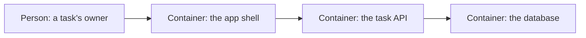
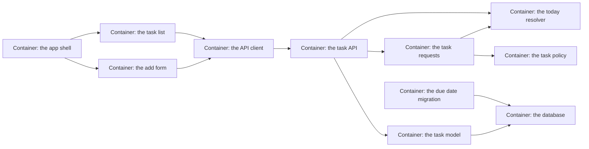
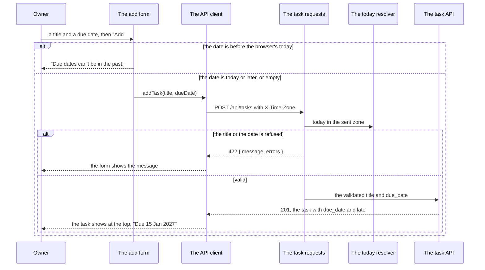
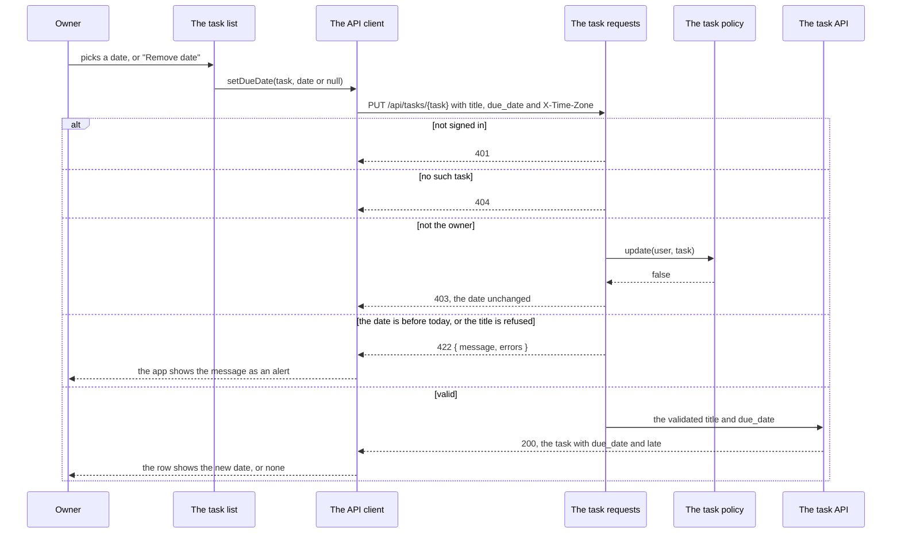
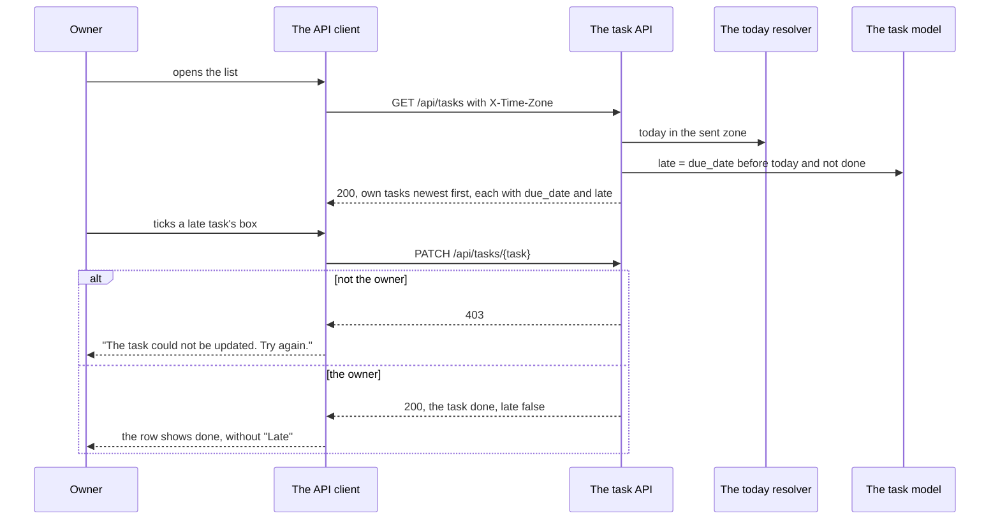

# Due dates: a date column on the task, judged in the browser's time zone

PRD: [Due dates on my own tasks](prd.md)

## Summary for approval

### The ask

Approve this design for due dates on each person's own tasks, built in today's API and list.

### Why

The due date is one optional column on the task, so a task without one is untouched (D-1). "Today" is judged in the time zone the browser sends, as ADR-0001 already decided (D-2). The server decides what is late, so the rule lives in one place (D-7).

### What changes

- Each task can carry a due date, set when it is added or later from the list (D-1, D-5).
- A date before today is refused with "Due dates can't be in the past." (D-4).
- The list shows "Due 15 Jan 2027" beside the title, and "Late" on a late task (D-7, D-8).
- Every browser request now sends its time zone, which no request does today (D-2).
- A missing or unknown time zone is judged in UTC, not refused (ADR-0001, D-3). A wrong zone shifts what counts as late or past.
- Editing a task checks its owner before anything else (D-6).
- Tasks without a date look and sort exactly as today (D-1, D-10).
- It ships in two steps: the database change and the API first, then the list. Rolling back drops the column and every date set with it (D-1).

### Decisions for you

1. Where does editing a task check its owner (D-6)? The edit's request class is missing, so no check can be read today. A: in the edit's request class, through the task policy, before the input check, as the tests expect (recommended). B: in the controller, after the input is checked, so a stranger's invalid edit gets 422, not 403. Written for: A.

### Not in this

- Everything the PRD leaves out: reminders, repeating tasks, a new sort order and a page of late tasks (NG-4).
- A time zone stored on each person: ADR-0001 settled that the browser sends it (NG-5).

## Goals and quality goals

The design lets an owner set, change and remove their tasks' dates and see the late ones. No one else sees them.

- Ana's task is due 2027-01-15, and Ben opens his list → his response holds 0 of her tasks and dates (NFR-1).
- Ben sends a due date for Ana's task → 403, and Ana's date is unchanged (NFR-1).

## Context and scope

- Outside the system: the browser, which supplies its time zone name from the tz database. The design builds nothing for it.
- NG-5: A time zone stored on each person. ADR-0001 chose the browser's zone per request instead, and this design follows it.

## Current state

- The list returns only the signed-in user's tasks, newest first, `backend/app/Http/Controllers/TaskController.php:17`.
- Adding a task creates it from the validated input only, `backend/app/Http/Controllers/TaskController.php:30`.
- Editing sets only the title and calls no `Gate::authorize`, `backend/app/Http/Controllers/TaskController.php:37`.
- Completing and deleting check the owner through the task policy, `backend/app/Http/Controllers/TaskController.php:45`.
- The task policy allows a change only to the task's owner, `backend/app/Policies/TaskPolicy.php:12`.
- The controller imports `StoreTaskRequest` and `UpdateTaskRequest`, but the repo has no `backend/app/Http/Requests/` folder, `backend/app/Http/Controllers/TaskController.php:5`.
- What those two classes check today is unverified, because they are missing.
- The API tests expect a stranger's edit to answer 403, `backend/tests/Feature/TaskApiTest.php:140`.
- They expect that 403 before the title is checked, `backend/tests/Feature/TaskApiTest.php:191`.
- They expect an edit to change only the title, `backend/tests/Feature/TaskApiTest.php:98`.
- A unit test expects the add and edit rules to be identical, `backend/tests/Unit/TaskRulesTest.php:32`.
- The task model allows mass assignment of the title only, `backend/app/Models/Task.php:11`.
- The task model casts only the done mark, `backend/app/Models/Task.php:24`.
- The title limit of 120 lives on the model, `backend/app/Models/Task.php:17`.
- Done is set and never cleared: there is no "not done" path, `backend/app/Models/Task.php:37`.
- The tasks table has a title and a done mark, and no date, `backend/database/migrations/2026_10_23_100000_create_tasks_table.php:15`.
- Editing is `PUT /api/tasks/{task}` and completing is `PATCH /api/tasks/{task}`, `backend/routes/api.php:16`.
- Every task route sits behind the Sanctum login, `backend/routes/api.php:9`.
- The repo lacks `backend/app/Models/User.php`, so the `tasks()` relation on the user is unverified, `backend/app/Policies/TaskPolicy.php:6`.
- The repo lacks the task factory the tests use, `backend/app/Models/Task.php:5`.
- The browser client sends only an `Accept` header, so no request carries `X-Time-Zone` yet, `frontend/src/api.ts:7`.
- No backend file reads `X-Time-Zone`: a search of `backend/` found none, so the server judges no date today, `backend/routes/api.php:9`.
- The client's task type has an id, a title and a done mark, `frontend/src/api.ts:3`.
- The client adds a task with its title only and has no edit call, `frontend/src/api.ts:23`.
- The list shows a checkbox and the title, `frontend/src/components/TaskList.tsx:20`.
- The add form checks the title early, before it sends, `frontend/src/components/AddTaskForm.tsx:15`.
- The app puts a new task at the top, `frontend/src/App.tsx:29`.
- The app replaces a completed task with the API's answer, `frontend/src/App.tsx:38`.
- The app shows a failed update as an alert, `frontend/src/App.tsx:41`.
- Every component needs a demo, checked by `frontend/src/demo/demos.test.tsx:21`.
- That test imports `./coverage`, which the repo lacks, `frontend/src/demo/demos.test.tsx:3`.

## Solution strategy

The tasks table gains one nullable date column. The task API reads and writes it through today's add and edit endpoints. One backend class turns the `X-Time-Zone` header into today's date, as ADR-0001 decided. The past-date check and the late mark both use it. The API adds a computed `late` flag to every task it returns, so the list only displays it. The list order, the done mark, the summary endpoint and the login stay as they are.

## Building blocks

| Component | Responsibility | Owner | Path |
|---|---|---|---|
| the task API | Lists, adds, edits and completes tasks; returns `due_date` and `late` on each task | The app team | `backend/app/Http/Controllers/TaskController.php` |
| the task requests | Check the title (required, at most 120 characters, on add and on edit) and the due date (optional, `YYYY-MM-DD`, not before today); the edit request checks the owner first | The app team | (new) `backend/app/Http/Requests/StoreTaskRequest.php`, (new) `backend/app/Http/Requests/UpdateTaskRequest.php`, both named by the controller and missing from the repo |
| the today resolver | Turns `X-Time-Zone` into today's date; UTC without the header or with an unknown zone | The app team | (new) `backend/app/Support/RequestToday.php` |
| the task policy | Allows a change only to the task's owner | The app team | `backend/app/Policies/TaskPolicy.php` |
| the task model | Holds `due_date` and the late rule | The app team | `backend/app/Models/Task.php` |
| the due date migration | Adds and drops the `due_date` column | The app team | (new) `backend/database/migrations/2026_11_27_100000_add_due_date_to_tasks_table.php` |
| the database | Stores the tasks | The app team | MySQL 8.4, `docker-compose.yml` |
| the API client | Sends `X-Time-Zone` on every request; adds a task with a date; sets or removes a date | The app team | `frontend/src/api.ts` |
| the add form | Takes an optional due date beside the title, and refuses a past date early | The app team | `frontend/src/components/AddTaskForm.tsx` |
| the task list | Shows "Due 15 Jan 2027" and "Late"; sets, changes and removes a task's date | The app team | `frontend/src/components/TaskList.tsx` |
| the app shell | Passes the add and date changes to the client, and shows a refusal as an alert | The app team | `frontend/src/App.tsx` |

## Key flows

Adding a task with a due date (UJ-1, FR-1, FR-4):

Setting, changing or removing the date of an existing task (FR-1, FR-4, NFR-1):

Opening the list, and completing a late task (FR-2, FR-3, FR-5):

## Data

| Entity | Owner | Change | Migration | Reversible |
|---|---|---|---|---|
| A task | The task API, through the task model | A nullable `due_date` column of type `DATE`, null for every existing task | (new) `2026_11_27_100000_add_due_date_to_tasks_table.php` adds the column; no backfill | Yes: the down migration drops the column, and every date set with it |

## Cross-cutting rules and conventions

| Rule | Applies to |
|---|---|
| A due date is a calendar day, `YYYY-MM-DD`, in JSON as `due_date`, or `null` for no date | The API, the API client |
| "Today" comes from the today resolver only: `X-Time-Zone` per ADR-0001, else UTC | The task requests, the task API |
| A refusal is 422 with Laravel's `{ message, errors }` body, from a Form Request class (conventions-backend) | The task requests |
| The past-date refusal says "Due dates can't be in the past." under `errors.due_date` | The task requests, the add form |
| A rule about a task lives on the task model; the frontend repeats it only to show the error early (conventions-backend) | The task model, the add form |
| Who may change a task is asked of the task policy, never by comparing IDs (conventions-backend) | The task requests, the task API |
| The browser formats a due date from its string, never through a `Date` in another zone, so the day never shifts | The task list |
| An API test signs in as a real user with `actingAs` (conventions-backend) | The API tests |

## Decisions

- D-1: The due date is one nullable `DATE` column on `tasks`, so a task without one stays exactly as today.
- D-2: [ADR-0001: Judge "today" in the time zone the browser sends with each request](../../decisions/ADR-0001-browser-time-zone.md)
- D-3: An unknown `X-Time-Zone` value is judged in UTC, as a missing header is, rather than refused. (Arlo's call)
- D-4: Both task requests hold the same past-date rule, so the add and edit rules stay equal. The add form repeats it early.
- D-5: A date is set, changed or removed through the existing `PUT /api/tasks/{task}`: `due_date` present sets it, `null` removes it, absent leaves it. (Arlo's call)
- D-6: The edit's request class asks the task policy before validation, so a stranger gets 403 first, as the tests expect.
- D-7: The server computes `late` on each task it returns, from the late rule on the task model; it is never stored. (Arlo's call)
- D-8: The list shows "Due 15 Jan 2027" after the title and the word "Late" on a late task. (Arlo's call)
- D-9: The date controls go inside the add form and the task list, so no new component or demo is needed. (Arlo's call)
- D-10: The list keeps its order, newest first by id, for dated and undated tasks alike, as the owner asked.

## Trace table

| ID | Component(s) | Decision | Note |
|---|---|---|---|
| FR-1 | the task API, the task requests, the task model, the due date migration, the API client, the add form, the task list | D-1 | D-5 for change and remove |
| FR-2 | the task API, the task list | D-8 | |
| FR-3 | the task API, the today resolver, the task model, the task list | D-7 | late from the day after the due date (A-1) |
| FR-4 | the task requests, the today resolver, the add form, the app shell | D-4 | D-2 for whose today |
| FR-5 | the task API, the task list | D-10 | D-1 keeps undated tasks unchanged |
| NFR-1 | the task API, the task requests, the task policy | D-6 | the list stays scoped to the user's own tasks |

## Risks and rollout

- Step 1: the migration, the today resolver, the task requests, the model and the API ship together. The new fields are additive, so today's list ignores them.
- Step 2: the API client, the add form, the task list and the app shell ship after step 1.
- No flag: until step 2 ships, nobody can set a date, so nothing shows.
- If only step 1 ships, the browser sends no `X-Time-Zone`, so the server uses UTC. No date exists yet, so nothing is judged.
- Rollback: revert step 2, then step 1, then run the down migration. The down migration drops every due date set.
- Risk: a browser whose clock or zone is wrong sees its own today; the server accepts that per ADR-0001.

## Deployment

Omitted: no new service or setting; the migration runs with the app's existing `php artisan migrate`.

## Observability

Omitted: the app has no metrics today, and SM-1 and SM-2 are read from the task data.

## Failure modes

- A request without `X-Time-Zone`, or with an unknown zone, is judged in UTC (ADR-0001, D-3).
- A past date that passes the form's early check is still refused by the API with 422 (D-4).

## Test strategy

- API tests in `backend/tests/Feature/TaskApiTest.php` sign in with `actingAs` and fix today with `Carbon::setTestNow`.
- They cover add, set, remove, the past refusal, late before and after completing, and Ben's 403 and list (NFR-1).
- Unit tests in `backend/tests/Unit/TaskRulesTest.php` cover the date rule and the late rule. The equal-rules test stays.
- Vitest tests cover the date text, the "Late" mark, removing a date and the add form's early past refusal.
- The J-1 and J-2 smoke test, `e2e/tests/smoke.spec.ts`, runs unchanged and must stay green.

## Constraints

- The app is hosted in the EU under GDPR. The due date stays in the existing tasks table (business.md).

## Glossary

Omitted: the PRD's glossary holds every term this design uses.
