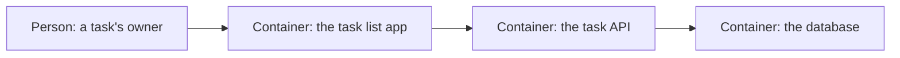
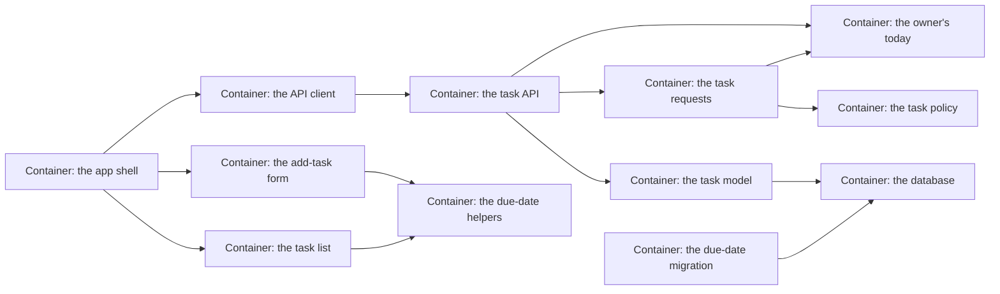
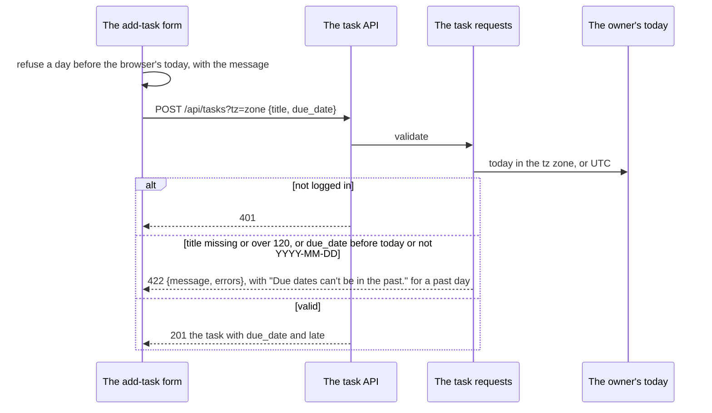
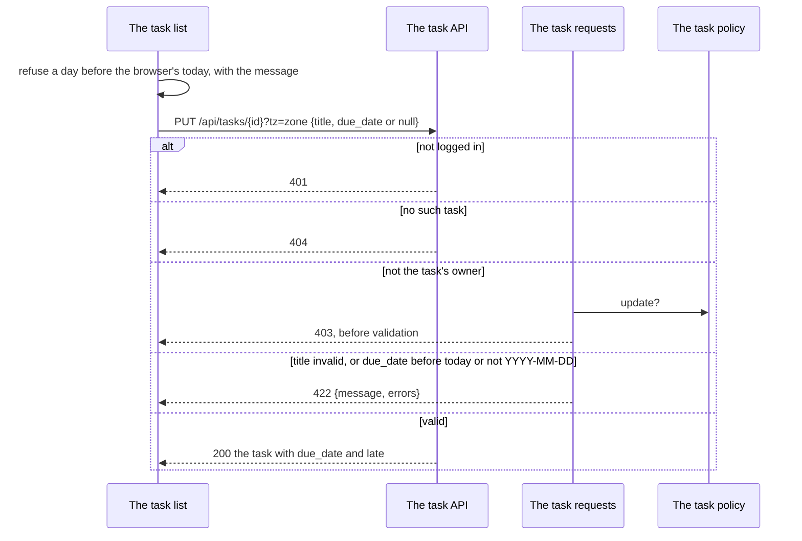
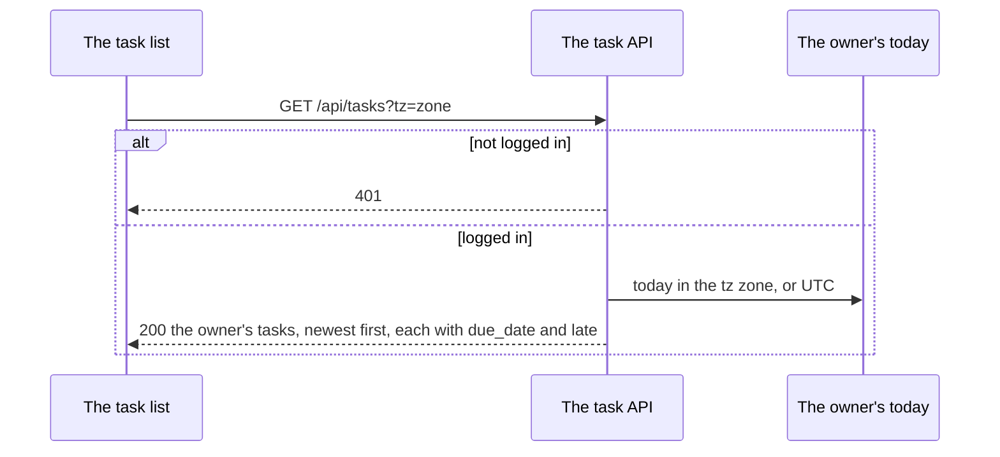
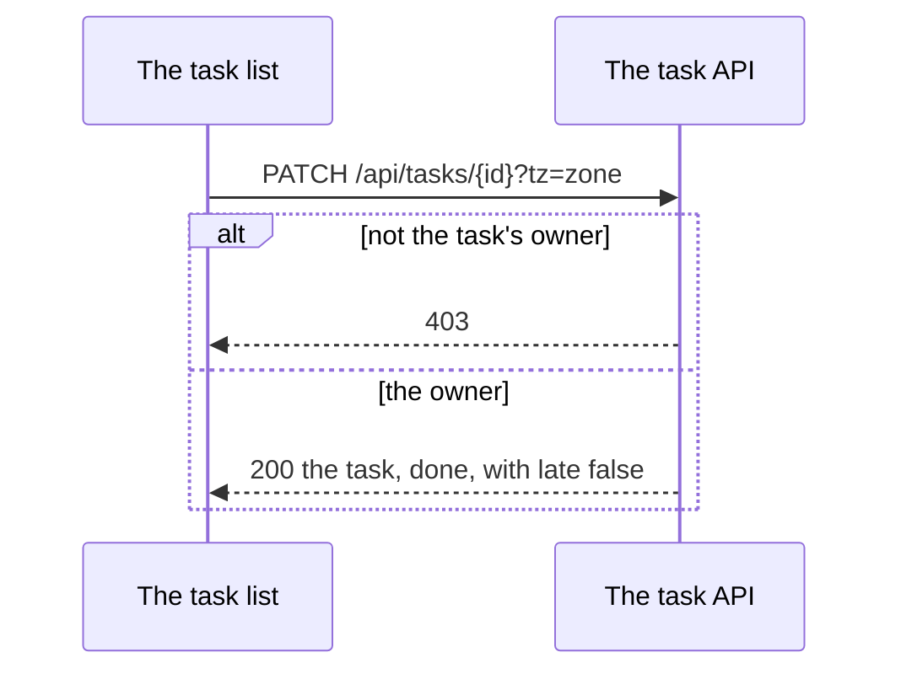

# Due dates on my own tasks: a date column, a late flag from the owner's today, and the list's mark

PRD: [Due dates on my own tasks](prd.md)

## Summary for approval

### The ask

Approve this design for due dates in the existing task API and list, so owners see which tasks are late.

### Why

The due date is a calendar day stored on the task itself, so a task without one is unchanged (ADR-0002). The server judges "past" and "late" against the owner's today, in the zone the browser sends as `tz` (ADR-0003). The list keeps its order and adds the date and a "Late" mark (D-4).

### What changes

- Each task gains an optional due date: a day with no time, set on adding or later (ADR-0002, D-1)
- The API refuses a date before the owner's today with "Due dates can't be in the past." (D-2)
- The API marks each open task past its date as late, judged in the browser's zone (D-3)
- The browser now sends its time zone as a `tz` query parameter on every request, as the proxy strips unknown headers (ADR-0003, D-12)
- The list shows "Due 15 Jan 2027" and "Late" beside the title, in today's order (D-4, D-5)
- An edit that leaves out the date keeps it, and an edit sending `null` removes it (D-7)
- A done task keeps its date control, though its checkbox stays locked as today (D-10)
- The two request classes the task API imports are missing from the repo, so the build adds them (D-6)
- It ships in two steps: the migration and the API first, then the list. Rolling back drops the column and every date (D-8)

### Decisions for you

1. How is a due date stored (ADR-0002)? A: a calendar day with no time and no zone (recommended). B: a UTC moment at the end of the due day, in the zone sent when it was set. The owner chose A in the interview (Q-4). Written for: A.
2. Where does an edit check the task's owner, now that the request classes must be added (D-6)? A: in the edit's request class, before validation, as the existing API tests expect (recommended). B: in the controller, as the conventions' example shows, so another owner's invalid edit answers 422 before 403. Written for: A.
3. Can an owner change the date of a done task (D-10)? A: yes, a done task keeps its date control, as FR-1 covers any of the owner's tasks (recommended). B: no, a done task's date is locked like its checkbox is today. Written for: A.
4. How is SM-1 (dated tasks done by their date) read (D-11)? A: from `updated_at` on done tasks, an approximate count, as any later edit moves it; no new column (recommended). B: a nullable `done_at` column, set when a task is marked done, for an exact count. This adds scope, so it goes through the PRD first. Written for: A.
5. Which requests carry `tz` (D-12)? A: every task request, the list's too, so "Late" stays judged in the owner's zone (recommended). B: only the writes, as the change asked, so the list judges "Late" in UTC. Written for: A.
6. Is a zone name in URL logs, which says roughly where an owner is, acceptable under GDPR (ADR-0003)? Who keeps the proxy's logs, and how long, is unverified. A: yes, with the proxy's logs kept in the EU (recommended). B: only if the proxy stops logging task requests' query strings. Written for: A.

### Not in this

- Reminders of any kind (NG-1)
- Repeating tasks (NG-2)
- A new sort order for the list (NG-3)
- A page of late tasks (NG-4)

## Goals and quality goals

Owners set, change and remove their tasks' due dates and see late tasks, and nobody else sees them.

- 2 owners with 1 dated task each → each owner's `GET /api/tasks` returns 0 of the other's tasks or dates (NFR-1).

## Context and scope

- Outside the system: the owner's browser, which knows its own time zone and sends it in the query string (ADR-0003).
- Outside the system too: the company proxy between the browser and the API, which strips unknown request headers (ADR-0003).
- Inside the system, nothing new runs: no job, no queue and no message.
- NG-1: Reminders, from the brief. The app sends no message of any kind.
- NG-2: Repeating tasks, from the brief. They need their own rules for what done means.
- NG-3: A new sort order for the list, from the brief. The owner asked to keep today's order.
- The PRD's NG-4 holds too: there is no page of late tasks, because the mark on the list is enough.

## Current state

- The list returns the owner's own tasks, newest first, `backend/app/Http/Controllers/TaskController.php:17`.
- Adding a task creates it from the validated input, `backend/app/Http/Controllers/TaskController.php:30`.
- Editing a task sets the title alone, and ignores every other field, `backend/app/Http/Controllers/TaskController.php:37`.
- Editing calls no policy in the controller, `backend/app/Http/Controllers/TaskController.php:35`, while completing and deleting do, `backend/app/Http/Controllers/TaskController.php:45`.
- The controller imports `StoreTaskRequest` and `UpdateTaskRequest`, `backend/app/Http/Controllers/TaskController.php:5`, but the repo has no `backend/app/Http/Requests` folder: both files are missing.
- The API tests expect an edit of another owner's task refused with 403 before validation, `backend/tests/Feature/TaskApiTest.php:191`. Where that check runs today is unverified, as the request classes are missing.
- A unit test expects the add and edit rules to be equal, `backend/tests/Unit/TaskRulesTest.php:30`.
- The task model allows only the title to be mass-assigned, `backend/app/Models/Task.php:11`, and holds the title's limit of 120, `backend/app/Models/Task.php:17`.
- The task policy lets only the task's owner change it, `backend/app/Policies/TaskPolicy.php:12`.
- The tasks table holds a title, a done flag and timestamps, and no date, `backend/database/migrations/2026_10_23_100000_create_tasks_table.php:14`.
- The task routes sit behind the login check, `backend/routes/api.php:9`, and edit is `PUT /api/tasks/{task}`, `backend/routes/api.php:16`.
- The browser's API client sends only an `Accept` header, and no time zone, `frontend/src/api.ts:7`.
- The browser's task type has an ID, a title and a done flag, `frontend/src/api.ts:3`, and the client has no edit call, `frontend/src/api.ts:24`.
- The add form checks the title's length before it sends, `frontend/src/components/AddTaskForm.tsx:15`.
- The list shows each task's checkbox and title, and locks a done task, `frontend/src/components/TaskList.tsx:16`.
- A new task goes to the top of the list, `frontend/src/App.tsx:29`.
- Each component needs a demo with an `Empty` export, `frontend/COMPONENTS.md:11`.
- No code in `backend`, `frontend` or `e2e` reads or sends a time zone today, neither `X-Time-Zone` nor `tz`, `frontend/src/api.ts:7`.
- `AuthController`, the `User` model and the task factory are referenced, `backend/routes/api.php:3`, but are missing from the repo too; this design doesn't touch them.

## Solution strategy

The tasks table gains one nullable `due_date` day, and the task model owns the late rule (ADR-0002). A new class gives the owner's today from the `tz` query parameter, or UTC without a valid one (ADR-0003). The add and edit request classes refuse a day before it, and every task the API returns carries `due_date` and `late`. The browser sends its zone as `tz` on every request, and shows the date and the mark. It repeats the past-date check only to show the message early. The list's order, the summary endpoint, completing, deleting and logging in stay as they are.

## Building blocks

| Component | Responsibility | Owner | Path |
|---|---|---|---|
| The task API | Returns each task with `due_date` and `late`; saves `due_date` on add, and on edit only when sent | The app team | `backend/app/Http/Controllers/TaskController.php` |
| The task requests | Validate the title (required, at most 120 characters) and the due date (optional, `YYYY-MM-DD`, not before the owner's today); the edit's class checks the owner first. The controller imports both, but the repo lacks them | The app team | (new) `backend/app/Http/Requests/StoreTaskRequest.php`, (new) `backend/app/Http/Requests/UpdateTaskRequest.php` |
| The owner's today | Gives today's date in the zone of the request's `tz` query parameter, or in UTC without a valid one | The app team | (new) `backend/app/Support/OwnerToday.php` |
| The task model | Holds `due_date` as a day, and the late rule: open, dated and before today | The app team | `backend/app/Models/Task.php` |
| The task policy | Lets only a task's owner change it, unchanged | The app team | `backend/app/Policies/TaskPolicy.php` |
| The due-date migration | Adds the nullable `due_date` column; its down drops it | The app team | (new) `backend/database/migrations/2026_11_27_100000_add_due_date_to_tasks_table.php` |
| The database | Stores the tasks table | The app team | `docker-compose.yml` |
| The API client | Sends `tz` on every request; adds a task with a date; sets or removes a date | The app team | `frontend/src/api.ts` |
| The due-date helpers | Format a day as "Due 15 Jan 2027"; give the browser's today; hold the past-date message | The app team | (new) `frontend/src/dueDate.ts` |
| The add-task form | Gains an optional "Due date" field, checked before it sends | The app team | `frontend/src/components/AddTaskForm.tsx` |
| The task list | Shows each task's date and "Late" mark; lets the owner change or remove the date | The app team | `frontend/src/components/TaskList.tsx` |
| The app shell | Passes the date to add, and swaps in the task the API returns after a date change | The app team | `frontend/src/App.tsx` |

## Key flows

Adding a task with a due date (FR-1, FR-4):

Changing or removing a task's due date (FR-1, FR-4, NFR-1):

Opening the list (FR-2, FR-3, FR-5, NFR-1):

Marking a task done (FR-3):

## Data

| Entity | Owner | Change | Migration | Reversible |
|---|---|---|---|---|
| A task | The task API, through the task model | A nullable `due_date` column of type `DATE`, after `title`; no index, as one owner's list is short | The due-date migration adds the column; existing rows get null, so no backfill | Yes: the down migration drops the column, and every date set with it |

## Cross-cutting rules and conventions

| Rule | Applies to |
|---|---|
| A due date is a day, `YYYY-MM-DD`, with no time and no zone, in the database, the API and the browser (ADR-0002) | The migration, the model, the API, the API client, the helpers |
| The browser never parses a due date with `new Date('YYYY-MM-DD')`, which reads it as UTC midnight and can shift the day | The helpers, the task list |
| "Today" is taken from the `tz` query parameter, or UTC when it is missing or not a known zone name; no `X-Time-Zone` header is read (ADR-0003) | The owner's today, the task requests, the task API |
| `late` is `true` only when the task is not done, has a due date, and that date is before today | The task model |
| Every task in a response carries `due_date` (a day or `null`) and `late` (a boolean) | Every task endpoint: list, add, edit, complete |
| A refusal is a 422 from a request class with Laravel's `{ message, errors }` body; a past day's message is "Due dates can't be in the past." | The task requests |
| The browser repeats a rule only to show the error early; the API's answer wins | The add-task form, the task list |

## Decisions

- D-1: [ADR-0002: Store a due date as a calendar day with no time and no zone](../../decisions/ADR-0002-due-date-calendar-day.md)
- D-2: The past-date rule sits in both request classes, so the add and edit rules stay equal as `TaskRulesTest` expects.
- D-3: The API computes `late` on each response from the owner's today, and stores no late flag, because lateness changes each day.
- D-4: The list shows "Due 15 Jan 2027" and the word "Late" by the title, so the mark needs no colour. (Arlo's call)
- D-5: The helpers format the month from a fixed English list, so every browser shows "Jan" and never a local spelling. (Arlo's call)
- D-6: The build adds the two missing request classes with the title's rules, and the edit's owner check before validation.
- D-7: An edit changes `due_date` only when the key is sent, and `null` removes it, so a title-only edit keeps the date. (Arlo's call)
- D-8: The migration and the API ship before the browser, because an older API drops the dates the new list sends. (Arlo's call)
- D-9: A `tz` naming no known zone counts as missing, so the day is judged in UTC, as ADR-0003 says. (Arlo's call)
- D-10: Done tasks keep their date control too, because FR-1 lets an owner change any of their tasks' dates. (open: the owner decides, Decisions for you 3)
- D-11: SM-1 is read from `updated_at` on done tasks, with no new column, because the PRD asks for no record of completion. (open: the owner decides, Decisions for you 4)
- D-12: [ADR-0003: Judge "today" in the time zone the browser sends as a `tz` query parameter on each request](../../decisions/ADR-0003-browser-time-zone-query-parameter.md), sent on reads too. (open: the owner decides, Decisions for you 5)

## Trace table

| ID | Component(s) | Decision | Note |
|---|---|---|---|
| FR-1 | The task API, The task requests, The task model, The due-date migration, The API client, The add-task form, The task list, The app shell | D-1 | set on add or later; removed by sending null (D-7) |
| FR-2 | The task API, The task list, The due-date helpers | D-4 | "Due 15 Jan 2027" beside the title (D-5) |
| FR-3 | The task model, The owner's today, The task API, The task list | D-3 | late from the day after, in the browser's zone (ADR-0003) |
| FR-4 | The task requests, The owner's today, The add-task form, The task list | D-2 | the browser checks first; the API decides |
| FR-5 | The task API, The task list | D-1 | null date: no date, no mark, same order |
| NFR-1 | The task API, The task requests, The task policy | D-6 | the date lives on the task row, read only through the owner's tasks |

## Risks and rollout

- Order: the migration and the API ship first, then the browser (D-8). No flag: a task without a date behaves as today.
- Half shipped, API only: the API accepts and returns dates nobody sets yet, and the list shows nothing new.
- Half shipped, browser only: the old API ignores `due_date`, so dates the owner enters are lost silently. D-8's order prevents it.
- Rollback: reverting the browser hides the feature and keeps the dates. The down migration drops the column and every date.
- A browser with a wrong clock can disagree with the API about today near midnight. The API's answer wins.
- The zone name shows in each request's URL, and so in any log of URLs (ADR-0003). Whether that is acceptable under GDPR is the owner's (Decisions for you 6).
- SM-1 counts tasks done by their date, but the app records no time of completion. Its count from `updated_at` is approximate (D-11).

## Deployment

Omitted: nothing new runs; the migration runs with the app's existing `php artisan migrate`.

## Observability

Omitted: the app has no metrics or logs today, and the success metrics are read from the task data.

## Failure modes

- A request without `tz`, or with an unknown zone, is judged in UTC (ADR-0003, D-9).
- Then an owner far from UTC can see "Late" some hours early or late.
- A malformed date is refused with 422, as any invalid field is today.

## Test strategy

- API tests in PHPUnit log in as a real user, with a fixed clock and a `tz` query parameter.
- They cover each acceptance criterion of FR-1 to FR-5 and NFR-1.
- Unit tests cover the late rule on the task model and the zone fallback of the owner's today.
- UI tests (Vitest) cover the date text, the "Late" mark, the early past-date message and a task with no date.
- The smoke test of J-1 and J-2 stays unchanged and must pass. A task without a date is added as today.
- The LLD maps each test to its acceptance criterion.

## Constraints

- The build fits the one week of the brief's appetite, inside the existing app, with no new service.
- Personal data stays in the EU database the app already uses (business.md).

## Glossary

Omitted: the PRD's glossary holds every term this design uses.
