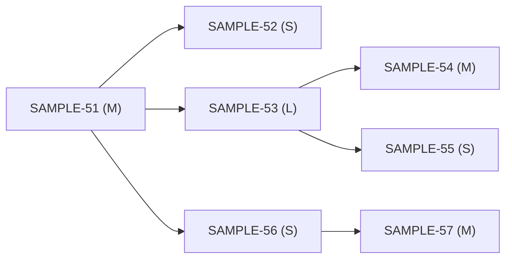

# Due dates and reminders, in seven tickets

PRD: [Tasks with due dates that people finish on time](prd.md)

## Summary for approval

### The ask

Approve these seven tickets for due dates and reminders, so that every requirement of the due-dates PRD is built.

### Why

The tickets build the whole due-dates PRD, and every requirement and acceptance criterion is in one of them. The date itself comes first, through every layer. The nightly reminder email comes next, because it is the part we are least sure of.

### What changes

- A task's creator or team lead can date it; a past date is refused (SAMPLE-51, SAMPLE-52; FR-1, FR-6).
- Reminder emails go out the evening before, with title and date only, retried once (SAMPLE-53, SAMPLE-54; FR-4, FR-7, NFR-2).
- Assignees can turn reminders off, and people who leave a team get none (SAMPLE-55; FR-3, FR-8).
- Overdue tasks are marked in the list, and team leads get an overdue page (SAMPLE-56, SAMPLE-57; FR-5, FR-2, NFR-1).
- Tasks without a date look and sort as they do today (SAMPLE-51; FR-9).

### Decisions for you

1. SAMPLE-53 is high risk and has an end-to-end test: a fault in the nightly job would email every assignee. Options: keep both, or drop the end-to-end test. Recommendation: keep both; its plan then always comes to you.

### Not in this

- Recurring tasks, text messages and a new sort order, which the brief leaves out (NG-1, NG-2, NG-3).
- Reminders for tasks with no assignee, which the PRD leaves out (NG-4).
- A closing refactor sweep ticket: each ticket is small, and each review checks its code (NG-5).

## Order

SAMPLE-51 is the tracer bullet: it stores, edits and shows a due date through every layer. SAMPLE-53 comes next, because the nightly email is the part we are least sure of. SAMPLE-54 and SAMPLE-55 build on the email and can run side by side. SAMPLE-52 and SAMPLE-56 need only the date, so they can run any time after SAMPLE-51. SAMPLE-57 needs the overdue mark from SAMPLE-56.

## Release

The release mode is `per-ticket`: each ticket goes live on its own once you merge it. Every step leaves undated tasks as they are today (FR-9), so no ticket waits for another.

## Not in this epic

These are left out of the set:

- Everything the brief and the PRD leave out (NG-1, NG-2, NG-3, NG-4).
- NG-5: A closing refactor sweep ticket. The seven tickets are small, and each review checks its own code.

## Tickets

<!-- generated by mirai epic render: edit the tickets, then run it again -->
| Key | Title | Size | Risk | After | FRs | ACs | ADRs |
|---|---|---|---|---|---|---|---|
| [SAMPLE-51](tickets/SAMPLE-51.md) | A task can carry a due date | M | normal | — | FR-1, FR-9 | AC-FR-1.1, AC-FR-1.2, AC-FR-1.3, AC-FR-9.1 | — |
| [SAMPLE-52](tickets/SAMPLE-52.md) | A due date in the past is refused | S | normal | SAMPLE-51 | FR-6 | AC-FR-6.1 | — |
| [SAMPLE-53](tickets/SAMPLE-53.md) | Assignees get one reminder email the evening before | L | high | SAMPLE-51 | FR-4, NFR-2 | AC-FR-4.1, AC-FR-4.2, AC-FR-4.3, AC-FR-4.4, AC-FR-4.5, AC-NFR-2.1 | — |
| [SAMPLE-54](tickets/SAMPLE-54.md) | A failed reminder is retried once | M | normal | SAMPLE-53 | FR-7 | AC-FR-7.1 | — |
| [SAMPLE-55](tickets/SAMPLE-55.md) | Assignees can turn reminders off, and leavers get none | S | normal | SAMPLE-53 | FR-3, FR-8 | AC-FR-3.1, AC-FR-8.1, AC-FR-8.2 | — |
| [SAMPLE-56](tickets/SAMPLE-56.md) | Overdue tasks are marked in the list | S | normal | SAMPLE-51 | FR-5 | AC-FR-5.1, AC-FR-5.2 | — |
| [SAMPLE-57](tickets/SAMPLE-57.md) | Team leads see the team's overdue tasks on one page | M | normal | SAMPLE-56 | FR-2, NFR-1 | AC-FR-2.1, AC-FR-2.2 | — |
<!-- end of the generated part -->

## Dependencies

<!-- generated by mirai epic render: edit the tickets, then run it again -->

<!-- end of the generated part -->

## Coverage

<!-- generated by mirai epic render: edit the tickets, then run it again -->
| ID | Group | Tickets |
|---|---|---|
| FR-1 | Capabilities | SAMPLE-51 |
| AC-FR-1.1 | Capabilities | SAMPLE-51 |
| AC-FR-1.2 | Capabilities | SAMPLE-51 |
| AC-FR-1.3 | Capabilities | SAMPLE-51 |
| FR-2 | Capabilities | SAMPLE-57 |
| AC-FR-2.1 | Capabilities | SAMPLE-57 |
| AC-FR-2.2 | Capabilities | SAMPLE-57 |
| FR-3 | Capabilities | SAMPLE-55 |
| AC-FR-3.1 | Capabilities | SAMPLE-55 |
| FR-4 | Triggers and states | SAMPLE-53 |
| AC-FR-4.1 | Triggers and states | SAMPLE-53 |
| AC-FR-4.2 | Triggers and states | SAMPLE-53 |
| AC-FR-4.3 | Triggers and states | SAMPLE-53 |
| AC-FR-4.4 | Triggers and states | SAMPLE-53 |
| AC-FR-4.5 | Triggers and states | SAMPLE-53 |
| FR-5 | Triggers and states | SAMPLE-56 |
| AC-FR-5.1 | Triggers and states | SAMPLE-56 |
| AC-FR-5.2 | Triggers and states | SAMPLE-56 |
| FR-6 | Failures | SAMPLE-52 |
| AC-FR-6.1 | Failures | SAMPLE-52 |
| FR-7 | Failures | SAMPLE-54 |
| AC-FR-7.1 | Failures | SAMPLE-54 |
| FR-8 | Failures | SAMPLE-55 |
| AC-FR-8.1 | Failures | SAMPLE-55 |
| AC-FR-8.2 | Failures | SAMPLE-55 |
| FR-9 | Unchanged behaviour | SAMPLE-51 |
| AC-FR-9.1 | Unchanged behaviour | SAMPLE-51 |
| NFR-1 | Non-functional | SAMPLE-57 |
| NFR-2 | Non-functional | SAMPLE-53 |
| AC-NFR-2.1 | Non-functional | SAMPLE-53 |
<!-- end of the generated part -->

## Design decisions

<!-- generated by mirai epic render: edit the tickets, then run it again -->
None — no ticket names an ADR in `governed_by`.
<!-- end of the generated part -->
