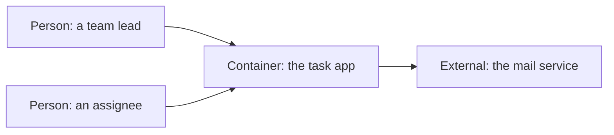
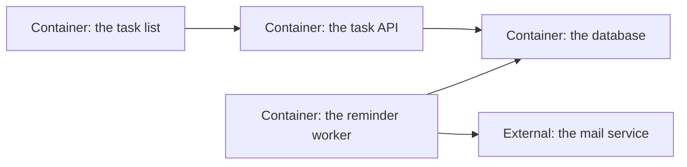
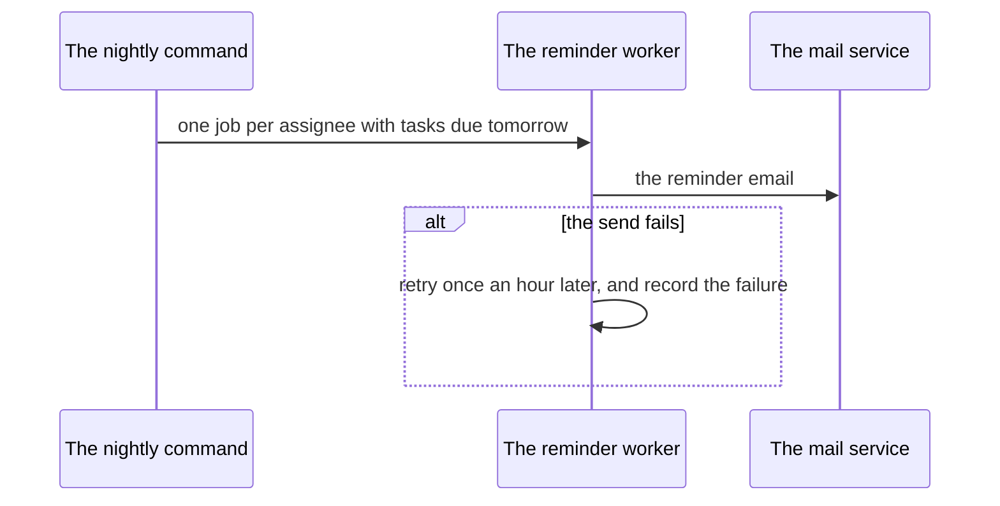

# Due dates: a dated task, an overdue page and a reminder queue

PRD: [Tasks with due dates that people finish on time](prd.md)

## Summary for approval

### The ask

Approve this design for due dates and reminders, built in the task API and one queue worker.

### Why

Due dates live on the task itself, so the list and the overdue page read one table (D-1). Reminders need a retry per email, which a nightly command can't give, so they go through a queue (ADR-0001).

### What changes

- Each task gains a due date, set and checked by the task API (D-1)
- Team leads get an overdue page, read from the task table with an index (D-2)
- Reminder emails go out as one queued job per assignee, retried an hour later (ADR-0001)
- A task with no due date behaves exactly as today (D-1)

### Decisions for you

1. How do reminder emails get sent (ADR-0001)? A: one queued job per assignee, with a worker process (recommended). B: one nightly command that sends them all. Written for: A.

### Not in this

- Reminders for tasks with no assignee, which the PRD leaves out (NG-4)
- A calendar view of due dates, which no requirement asks for (NG-5)

## Goals and quality goals

Each requirement is met within the two quality goals the PRD sets.

- 500 open tasks in a team → the overdue page shows within 2 seconds (NFR-1).
- A description holding a salary → the email shows only the title and the date, 1 email per assignee (NFR-2).

## Context and scope

- Outside the system: the mail service, which delivers the emails the app sends.
- NG-5: A calendar view of due dates. No requirement asks for one, and the list shows the dates.

## Current state

- The task list returns the user's own tasks, newest first, `backend/app/Http/Controllers/TaskController.php:17`.
- Only a task's owner may change it, `backend/app/Policies/TaskPolicy.php:12`.
- The tasks table has a title and a done flag and no date, `backend/database/migrations/2026_10_23_100000_create_tasks_table.php:15`.
- The app runs no queue worker today: unverified, no worker service was found.

## Solution strategy

The task API gains the due date and the overdue list; the task table gains the column and an index. Reminders are a nightly command that queues one job per assignee, and a worker that sends them. Logins, the task form's other fields and tasks without a date stay as they are.

## Building blocks

| Component | Responsibility | Owner | Path |
|---|---|---|---|
| The task API | Due dates on tasks, the overdue list, the reminder setting | The app team | `backend/app/Http/Controllers/TaskController.php` |
| The task policy | Who may set a due date | The app team | `backend/app/Policies/TaskPolicy.php` |
| The task list | Shows the date and the overdue mark | The app team | `frontend/src/components/TaskList.tsx` |
| The reminder worker | Sends one email per assignee, retried an hour later | The app team | (new) `backend/app/Jobs/SendDueReminder.php` |

## Key flows

## Data

| Entity | Owner | Change | Migration | Reversible |
|---|---|---|---|---|
| A task | The task API | A nullable due date, with an index | A new migration adds the column and the index | Yes: the down migration drops both |
| A user | The task API | A reminders-off flag | A new migration adds the flag, off for no one | Yes: the down migration drops it |

## Cross-cutting rules and conventions

| Rule | Applies to |
|---|---|
| A due date is a day, `YYYY-MM-DD`, judged in the team's time zone | The API, the list, the worker |
| Errors are a JSON body with a message and a machine code | Every endpoint |
| A reminder email holds the task's title and date only | The worker |

## Decisions

- D-1: The due date is a nullable column on the task, so a task without one is unchanged.
- D-2: The overdue page filters in the database on an index, to stay within 2 seconds. (Arlo's call)
- D-3: [ADR-0001: Send due-date reminders from a queue worker](../../decisions/ADR-0001-reminder-queue.md)

## Trace table

| ID | Component(s) | Decision | Note |
|---|---|---|---|
| FR-1 | The task API, The task policy | D-1 | |
| FR-2 | The task API | D-2 | |
| FR-3 | The task API | | the reminders-off flag |
| FR-4 | The reminder worker | D-3 | |
| FR-5 | The task list | D-1 | |
| FR-6 | The task API | D-1 | |
| FR-7 | The reminder worker | D-3 | |
| FR-8 | The reminder worker | D-3 | |
| FR-9 | The task list | D-1 | |
| NFR-1 | The task API | D-2 | |
| NFR-2 | The reminder worker | D-3 | |

## Risks and rollout

- The migrations ship first, then the API and the list, then the overdue page, then the worker.
- No flag: a task without a date behaves as today, so a half-shipped feature shows dates and nothing else.
- If the worker isn't running, the jobs wait in the queue and send once it starts.

## Deployment

The worker runs as one more service beside the app, started with the app.

## Observability

Omitted: the app has no metrics today, and the failure record covers the reminders.

## Failure modes

Omitted: the only new failure is a failed email, handled in Key flows.

## Test strategy

Omitted: each ticket's plan holds its tests; the LLD maps them to the acceptance criteria.

## Constraints

Omitted: the PRD names no constraint beyond its requirements.

## Glossary

Omitted: the PRD's glossary holds every term this design uses.
