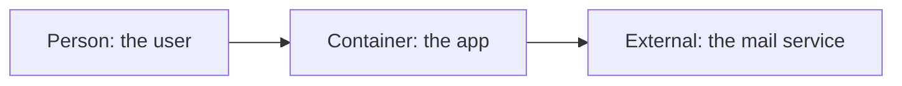
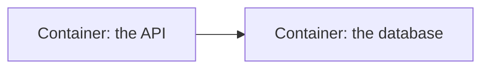
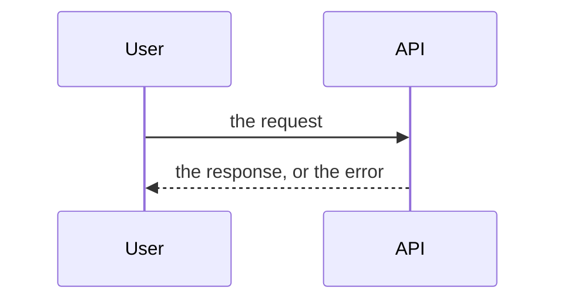

<!--
The high-level design template (MIRAI, unit 62). Replace every line below; keep the headings. mirai
lint flags any line or the id left word for word from this template.
- Two readers. "Summary for approval" is for the owner, who decides from it in about 15 minutes.
  Write it LAST, in at most 600 words. Everything after it is for the agents who cut the tickets
  and build: complete enough to build without guessing.
- It links ADRs and never repeats them. A choice that is hard to reverse, cross-cutting, about an
  NFR, an external dependency or the first of its kind is an ADR (mirai adr new <slug>); any other
  choice is one D-n line. A D-n line the author decided alone ends with "(Arlo's call)".
- `lld`: required, with `lld_triggers` (entity, contract, modules, state), when the work adds or
  changes a stored entity, an external contract, spans modules that could pick different shapes,
  or has a non-trivial state machine; else not-required, with `lld_reason`.
- Diagrams are Mermaid flowcharts with C4 labels (Person:, Container:, External:), and a
  sequenceDiagram per key flow.
- Cite the code in "Current state" as `path:line`, or say "unverified". Elsewhere name modules.
- About 4,000 words in all. An optional section that doesn't apply keeps one line: Omitted: <reason>.
- No status field: the store holds the HLD's status.
-->
# The feature, and how it is built, in a few words

<!-- done when: the line links the PRD this HLD designs, by its title -->
PRD: [The PRD's title](prd.md)

## Summary for approval

### The ask

<!-- done when: one sentence of at most 30 words starts with Approve and names the design and the outcome it delivers -->
Approve the design of the feature named here, so that the PRD's requirements are built this way.

### Why

<!-- done when: two to four sentences say what shape the design takes and why this shape, citing the PRD and the ADRs rather than repeating them -->
The shape of the design in a sentence, and the reason for it, pointing to the ADR that holds it.

### What changes

<!-- done when: three to seven bullets say what is new or different in the system, each ending with the components or D-n it sums up -->
- A new component and what it does (D-1)
- What an existing component does differently (D-2)
- What stays as it is today (D-2)

### Decisions for you

<!-- done when: each item is a question, its options lettered A:, B: (and C:), one marked (recommended), and "Written for: <letter>", the option this document is written for, with the ADR or D-n it rests on; or one line: None — <why nothing needs your call> -->
1. The load-bearing choice this design makes (ADR-0001)? A: the first option (recommended). B: the second option. Written for: A.

### Not in this

<!-- done when: each bullet is something this design leaves out, with a short reason and its NG-n: the PRD's, or a new one this HLD defines under Context and scope -->
- Something this design leaves out, and its reason (NG-1)

## Goals and quality goals

<!-- done when: one sentence on what the design must achieve; then the top three to five quality goals, each a scenario with the PRD's number, ending with its NFR-n: "500 open tasks → the overdue page shows within 2 s (NFR-1)" -->
The design must deliver the PRD's requirements within the quality goals below.

- The load, such as 100 open tasks → the response, such as within 3 seconds (NFR-1).

## Context and scope

<!-- done when: a context diagram (Person:, External:, Container:) shows who and what the system talks to; then what is outside the system, and the non-goals -->

- Outside the system: what the design relies on but doesn't build.
- NG-1: Something someone could reasonably want that this design leaves out, and why.

## Current state

<!-- done when: each bullet says what the code does today where this design touches it, citing `path:line`, or "unverified" when it couldn't be checked -->
- What the code does today here, `src/the/module.ext:12`.

## Solution strategy

<!-- done when: three to five sentences give the approach and what isn't changing -->
The approach in a few sentences, and what stays as it is.

## Building blocks

<!-- done when: a container diagram (Container: labels) and a table with one row per component: its responsibility, its owner, and its path (or (new)) -->

| Component | Responsibility | Owner | Path |
|---|---|---|---|
| The API | What it is responsible for | The team | `src/the/module.ext` |

## Key flows

<!-- done when: one sequenceDiagram per key flow, each with its error path -->

## Data

<!-- done when: one row per entity: who owns it, what changes, the migration, and whether it can be undone -->
| Entity | Owner | Change | Migration | Reversible |
|---|---|---|---|---|
| The entity | The API | The column it gains | The migration that adds it | Yes: the down migration drops it |

## Cross-cutting rules and conventions

<!-- done when: one row per rule every part follows: naming, IDs, date formats, the error shape, logging, security -->
| Rule | Applies to |
|---|---|
| The rule every part follows | Where it applies |

## Decisions

<!-- done when: each real choice is one line, D-1, D-2 …: the choice and its reason; one that passes the ADR test links its ADR instead; one the author decided alone ends with (Arlo's call) -->
- D-1: [ADR-0001: The load-bearing decision](../../decisions/ADR-0001-slug.md)
- D-2: The choice made and its reason, in a few words.

## Trace table

<!-- done when: one row per FR and NFR of the PRD: its component(s) from Building blocks, its decision (a D-n of this HLD or an ADR), and a note; deferred: <reason> in place of a component when it is left for later -->
| ID | Component(s) | Decision | Note |
|---|---|---|---|
| FR-1 | The API | D-2 | |

## Risks and rollout

<!-- done when: the order of changes, a flag, what breaks if half of it ships, and the rollback -->
- The order the changes ship in, the flag that guards them, and how to roll back.

## Deployment

Omitted: the reason this section doesn't apply to this design.

## Observability

Omitted: the reason this section doesn't apply to this design.

## Failure modes

Omitted: the reason this section doesn't apply to this design.

## Test strategy

Omitted: the reason this section doesn't apply to this design.

## Constraints

Omitted: the reason this section doesn't apply to this design.

## Glossary

Omitted: the reason this section doesn't apply to this design.
