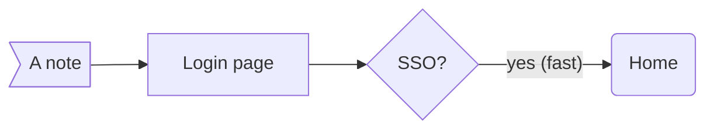

# Login

Staff sign in to the people tool.

## Summary

Staff log in with SSO. See [the requirements](#requirements), the
[billing summary](../billing/prd.md#summary) and [our site](https://example.com/docs).



<!-- done when: one paragraph says who signs in and how -->

## Requirements

### FR-1: Sign in

- AC-FR-1.1: a staff member signs in with SSO.
- AC-FR-1.2: a wrong password shows an error (`FR-9` in code doesn't count).

### FR-2: Sign out

- AC-FR-2.1: signing out clears the session, as in FR-1.

| Risk | Note |
|---|---|
| R-1 | SSO outage |

```text
FR-77 and [a link](missing.md) inside a fence don't count
```

## Risks

Not applicable — an internal tool with no outside users.
